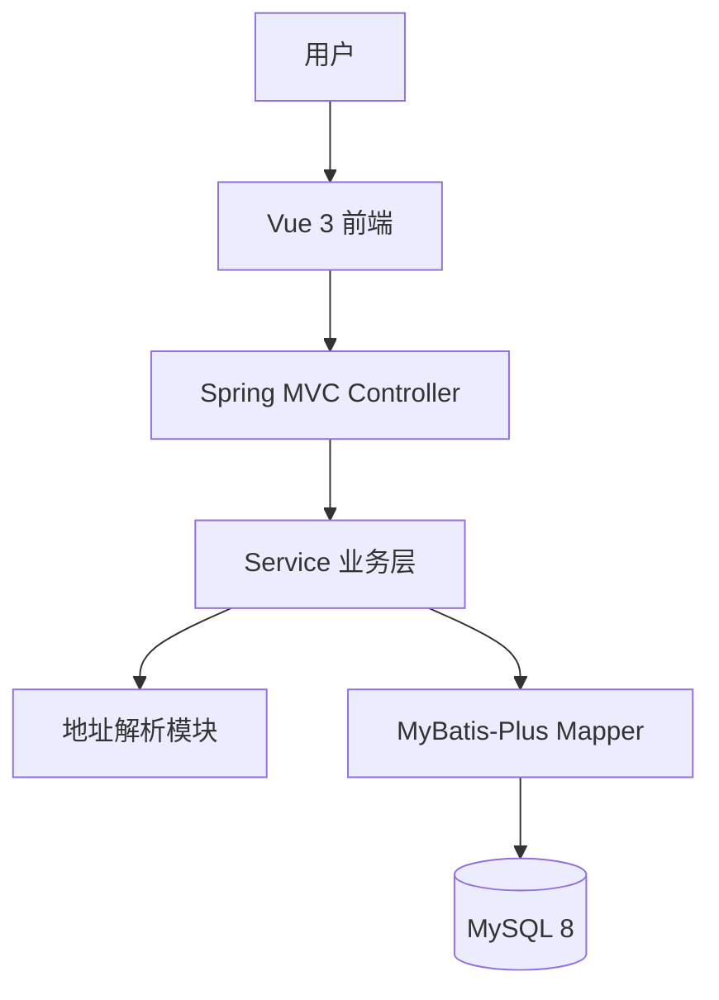
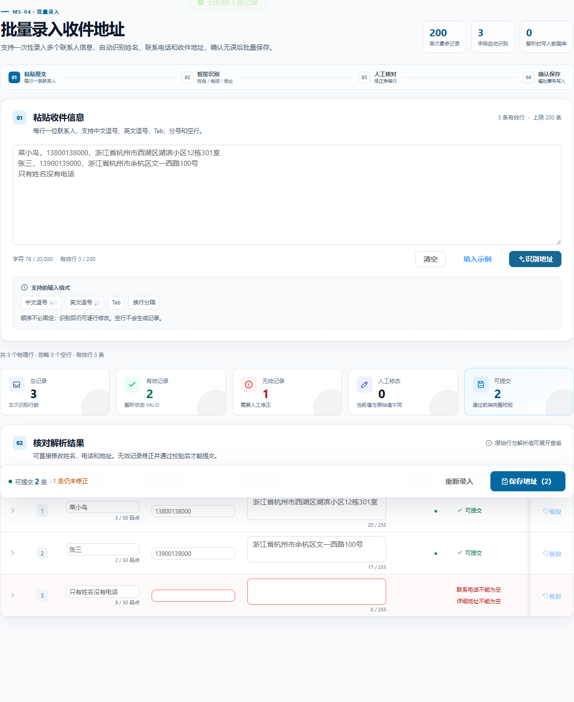
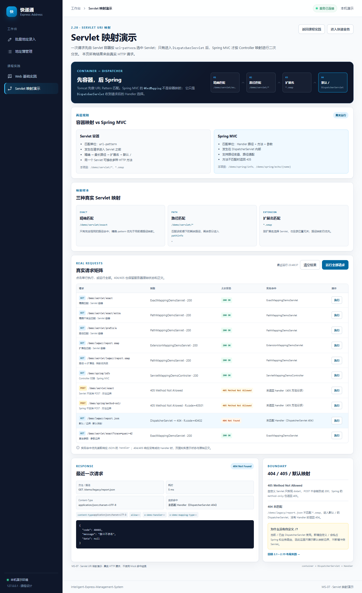

# 快递通——智能快递地址簿录入与管理系统

> 课程设计项目：**快递地址簿录入程序设计**
> 仓库标识：`Intelligent-Express-Management-System`
> 对应《高级 Web 项目开发（实践）》任务书任务（一）

这是一个面向课程设计的快递地址簿录入与管理系统，支持多行文本录入、规则解析、人工校正、确认保存和地址簿管理，同时包含 CSS 布局实践与 Servlet 请求映射演示。**本项目是本机课程设计演示，不是商业级快递管理平台。**

---

## 2. 项目简介

快递收件信息常以多行文本出现，格式不统一，人工逐条录入容易把姓名、电话和地址混在一起。本项目把这些文本按行交给规则解析器，提取收件人、电话和完整地址，在预览表中允许人工修正，用户确认后再批量写入地址簿；地址簿提供查询、分页、新建、编辑、逻辑删除和当前页批量删除。

项目同时承担课程中的 Web 基础实践：`/web-basics` 覆盖 2.1～2.19 的显示类型、盒模型、常规流、定位和线框布局，`/servlet-demo` 覆盖 2.20 的 Servlet 容器映射与 Spring MVC 对照。系统没有登录、权限、AI 解析、OCR、地图、Excel 或物流下单能力，这些均未实现。

**核心流程：** 粘贴多行文本 → 识别 → 预览与人工修正 → 保存确认 → 批量保存 → 地址簿查询/编辑/删除。

---

### 2.1 当前状态

| 项目 | 状态 |
| --- | --- |
| MS-01～MS-08 主要开发 | 已完成实施；MS-08 因 D08 尚未正式结束 |
| MS-08-R1 补充核验 | 已完成 |
| MS-08-R2 风险分析/人工方案 | 已完成 |
| MS-09 论文与截图 | **PARTIAL**：正文、Word/PDF 已生成；封面信息待填，2.21 四张业务截图 BLOCKED |
| MS-10 验收与答辩准备 | **未开始** |
| 后端测试 | **160 tests，0 failures/errors/skips**（隔离 Schema） |
| 前端构建 | `npm run build` 通过 |
| Chrome / Edge | Chrome 全量回归；Edge 完整矩阵通过 |
| 性能 | 100 行解析 P95 2.81ms；10000 条分页 P95 3.59ms（本机 30 样本） |
| GitHub Actions CI | **NOT RUN** |
| D08 / AC-30 | **P1 OPEN / PARTIAL** |
| AC-31 / AC-32 | PASS / PASS（本地验证，CI NOT RUN） |

> MS-08 尚未正式结束；AC-30 不能标记 PASS。MS-09 完成论文不等于 MS-08 风险关闭。

---

## 3. 项目功能

### 3.1 智能地址录入

- 多行文本粘贴，按物理行切分并保留原始行号；
- 支持中文/英文逗号、Tab、中文/英文分号分隔；
- 提取收件人姓名、手机号/座机号和完整地址；
- 预览有效/无效行、原始值、当前值和字段长度；
- 人工修改姓名、电话、地址，支持恢复原始值；
- 无效行不进入保存请求，保存前显示待修正原因；
- 保存确认弹窗展示有效、修改、异常和实际提交数量；
- 解析与保存分离，解析 API 不写数据库。

### 3.2 地址簿管理

- 地址列表、分页和总数显示；
- 姓名、电话、地址关键词搜索；
- 新建地址、编辑地址；
- 单条逻辑删除，删除二次确认；
- 当前页多选批量删除，批量删除二次确认；
- 删除使用 `is_deleted` 逻辑删除，不做物理清库。

### 3.3 Web 基础实践

`/web-basics` 及 `/web-basics/wireframe` 提供真实可交互的 2.1～2.19 演示：

- 行内、区块、行内区块显示类型；
- Flex 一维布局、Grid 二维布局；
- 盒模型四部分、标准盒模型、替代盒模型；
- 常规流、相对/绝对/固定/粘性定位；
- 定位偏移、定位上下文、sticky 约束矩形和覆盖规则；
- 2.18 原创线框与真实 AppLayout 的区域高亮。

### 3.4 Servlet 映射演示

`/servlet-demo` 与后端真实 Servlet/Controller 展示：

- 精确匹配 `/demo/servlet/exact`；
- 路径前缀匹配 `/demo/servlet/*`；
- 扩展名匹配 `*.smap`；
- 默认 `/` 与 DispatcherServlet；
- Spring MVC 对照 `/demo/spring/info`；
- `requestURI`、`contextPath`、`servletPath`、`pathInfo`；
- GET、HEAD、OPTIONS、POST 的真实行为；
- POST 405 且 `Allow: GET, HEAD, OPTIONS`。

---

## 4. 技术栈

版本以当前 `pom.xml`、`package.json` 和 `package-lock.json` 的实际安装结果为准。

| 层 | 技术 | 实际版本 |
| --- | --- | --- |
| 后端语言 | Java | 17（Temurin 17.0.21） |
| 后端框架 | Spring Boot / Spring MVC | 3.3.5 |
| 持久层 | MyBatis-Plus | 3.5.7 |
| 数据库 | MySQL | 8.0.43，InnoDB，utf8mb4 |
| 校验 | Jakarta Validation | 随 Spring Boot 3.3.5 |
| 后端测试 | JUnit 5、Maven Surefire | Java 17 / Maven 3.9.11 |
| 前端 | Vue | 3.5.45（`package.json` 范围 `^3.5.13`） |
| 类型 | TypeScript | 5.7.3（范围 `~5.7.2`） |
| 构建 | Vite | 5.4.21（范围 `^5.4.11`） |
| UI | Element Plus | 2.14.8（范围 `^2.9.1`） |
| 请求 | Axios | 1.21.1（范围 `^1.7.9`） |
| 路由 | Vue Router | 4.6.5（范围 `^4.5.0`） |
| 样式 | Sass | 1.108.2（范围 `^1.83.0`） |
| 浏览器测试 | Playwright | 1.65.1 |
| 浏览器 | Chrome、Microsoft Edge | 本机实际验证 |

---

## 5. 系统架构



调用边界：

- Parser 是纯逻辑模块，不依赖 Mapper、JDBC、MyBatis-Plus 或 IO；
- Controller 不直接访问 Mapper；
- 解析请求只调用 Parser，不写数据库；
- 保存请求由 Service 执行二次校验和事务；
- 批量保存失败整批回滚；
- Web 实践页和 Servlet 演示页与地址业务数据解耦。

---

## 6. 项目目录

```text
Intelligent-Express-Management-System/
├── AGENTS.md
├── README.md
├── backend/
│   ├── pom.xml
│   └── src/main/java/com/express/addressbook/
│       ├── controller/        # REST Controller
│       ├── service/           # 业务与事务
│       ├── mapper/            # MyBatis-Plus Mapper
│       ├── parser/            # 纯规则解析
│       ├── dto/ vo/ entity/   # 数据契约
│       ├── servlet/ demo/     # 2.20 Servlet 演示
│       └── common/ config/    # 统一响应、异常、配置
├── frontend/
│   ├── package.json
│   ├── scripts/               # Playwright 检查脚本
│   └── src/
│       ├── views/             # 录入、地址簿、Web 实践、Servlet 演示
│       ├── components/        # import/address/basics
│       ├── api/ layout/ router/ styles/ types/ utils/
├── docs/
│   ├── screenshots/           # 真实截图
│   ├── review/                # 各里程碑审计与交付报告
│   ├── security/              # D08 风险与人工处置指南
│   ├── test-results/          # 测试与性能原始记录
│   ├── paper/                 # MS-09 论文源稿与缺信息清单
│   └── *.md                   # 需求、架构、数据库、API、解析、测试、路线图
├── deliverables/MS-09/        # Word/PDF、图表/表清单、交付报告
└── docs/paper/                # 论文 Markdown、构建脚本、待补信息
```

---

## 7. 数据库设计

- 正式业务 Schema：`express_address_book`；
- 测试/性能隔离 Schema：`express_address_book_ms08_test`（历史测试库 `express_address_book_test` 未清理）；
- 存储引擎 InnoDB，字符集 `utf8mb4`，排序规则 `utf8mb4_0900_ai_ci`；
- 业务表：`express_address`。

| 字段 | 类型 | 约束/说明 |
| --- | --- | --- |
| `id` | BIGINT | 主键，自增；前端按字符串处理 |
| `receiver_name` | VARCHAR(50) | 非空；1～50 个 Unicode 码点 |
| `phone` | VARCHAR(20) | 非空；保存前规范化 |
| `full_address` | VARCHAR(255) | 非空；保留完整原文和内部标点 |
| `create_time` | DATETIME | 默认当前时间 |
| `update_time` | DATETIME | 更新自动刷新 |
| `is_deleted` | TINYINT | 0 未删除，1 已删除；逻辑删除 |

索引：`PRIMARY KEY(id)`、`idx_deleted_create(is_deleted, create_time)`、`idx_phone(phone)`。

数据库口令只通过本地环境变量或未跟踪的 `application-local.yml` 提供，**不得写入 README 或 Git**。

---

## 8. API 接口

| 方法 | URI | 功能 |
| --- | --- | --- |
| GET | `/api/health` | Web 服务存活，不检查数据库 |
| GET | `/api/health/db` | 应用账号执行数据库健康检查 |
| POST | `/api/addresses/parse` | 解析多行文本，不写数据库 |
| GET | `/api/addresses` | 分页 + 姓名/电话/地址关键词查询 |
| GET | `/api/addresses/{id}` | 查询单条地址 |
| POST | `/api/addresses` | 新建单条地址 |
| PUT | `/api/addresses/{id}` | 编辑单条地址 |
| DELETE | `/api/addresses/{id}` | 单条逻辑删除 |
| POST | `/api/addresses/batch` | 批量保存（事务，最多 200 条） |
| POST | `/api/addresses/batch-delete` | 批量逻辑删除 |

统一响应：

```json
{ "code": 0, "message": "OK", "data": {} }
```

`data.violations[]` 用于请求字段错误（40001）；`data.items[].errors[]` 用于解析行错误；数量/长度超限使用 40003。解析输入上限：`rawText` 非空、≤20000 字符、有效行 ≤200。

---

## 9. 环境要求

| 项 | 要求 |
| --- | --- |
| 操作系统 | Windows（当前本机验证环境）；命令示例同时给出 PowerShell |
| JDK | 17（LTS） |
| Maven | 3.9+ |
| Node.js | 20 LTS 或 22 LTS；本机验证 22.14.0 |
| npm | 随 Node.js；本机验证 10.9.2 |
| MySQL | 8.0.x，utf8mb4 |
| 浏览器 | Chrome 或 Microsoft Edge（Playwright） |
| 端口 | 后端 8080、前端 5173、MySQL 3306；应用仅监听 `127.0.0.1` |

---

## 10. 本地运行

### 10.1 数据库准备

```bash
mysql -u root -p < backend/src/main/resources/db/schema.sql
```

可选导入脱敏演示数据：

```bash
mysql -u root -p express_address_book < backend/src/main/resources/db/data.sql
```

本机课程演示可使用 `root@localhost`，但必须：

- 只监听 `127.0.0.1`；
- 不创建 `root@'%'`；
- 不向公网开放 3306/33060；
- 口令通过环境变量或本地未跟踪配置提供。

PowerShell 示例：

```powershell
$env:DB_URL = "jdbc:mysql://127.0.0.1:3306/express_address_book?useUnicode=true&characterEncoding=utf8&serverTimezone=Asia/Shanghai"
$env:DB_USERNAME = "root"
$env:DB_PASSWORD = "<本机口令>"
```

不要把真实口令写入 README、脚本或提交记录。

### 10.2 启动后端

```powershell
cd backend
mvn spring-boot:run
```

或打包运行：

```powershell
mvn clean package
java -jar target/express-address-book-0.1.0-SNAPSHOT.jar
```

后端配置：`server.address=127.0.0.1`，`server.port=8080`；JDBC 默认 `127.0.0.1:3306/express_address_book`。

### 10.3 启动前端

```powershell
cd frontend
npm install
npm run dev
```

Vite 配置为 `127.0.0.1:5173`，代理 `/api` 和 `/demo` 到 `http://127.0.0.1:8080`。

### 10.4 访问地址

```text
前端：http://127.0.0.1:5173
后端：http://127.0.0.1:8080
健康检查：http://127.0.0.1:8080/api/health
```

端口以当前 `application.yml` 与 `vite.config.ts` 为准；不要把应用暴露到局域网或公网。

---

## 11. 测试说明

### 11.1 后端

已验证隔离 Schema：

```powershell
$env:DB_URL = "jdbc:mysql://127.0.0.1:3306/express_address_book_ms08_test?useUnicode=true&characterEncoding=utf8&serverTimezone=Asia/Shanghai"
$env:DB_USERNAME = "root"
$env:DB_PASSWORD = "<本机口令>"
cd backend
mvn -B clean test
```

实际结果：

```text
Tests run: 160, Failures: 0, Errors: 0, Skipped: 0
BUILD SUCCESS
```

覆盖：Parser 单元测试、Controller/MockMvc、真实 HTTP、MySQL 集成、DTO 校验、Unicode 码点、LIKE 转义、批量事务、200/201 边界、`isEdited`、405/HEAD/OPTIONS。未配置 MySQL 时，相关测试可能跳过；**跳过结果不等于 160 项全部通过**。`express_address_book_ms08_test` 必须提前存在，且不能指向主库或旧测试库。

### 11.2 前端构建

```powershell
cd frontend
npm run build
```

### 11.3 Playwright

```powershell
cd frontend
node scripts/ms04-browser-check.mjs
node scripts/ms05-browser-check.mjs
node scripts/ms06-2-browser-check.mjs
# … ms06-3 至 ms06-9
node scripts/ms07-3-browser-check.mjs
node scripts/ms08-e2e-check.mjs
node scripts/ms08-edge-check.mjs
node scripts/ms08-perf-check.mjs
```

已实际得到：

```text
MS04_BROWSER_OK
MS05_BROWSER_OK
MS06_2_BROWSER_OK … MS06_9_BROWSER_OK
MS07_3_BROWSER_OK
MS08_E2E_OK
MS08_EDGE_OK
MS08_PERF_OK
```

### 11.4 性能

| 测试场景 | 平均耗时 | 中位数 | P95 |
| --- | ---: | ---: | ---: |
| 100 行解析 HTTP | 2.29ms | 2.12ms | 2.81ms |
| 10000 条分页查询 | 3.12ms | 3.10ms | 3.59ms |

- 30 个有效样本，预热 2 次；
- 真实 HTTP 请求；
- 分页查询使用隔离 Schema 中 10000 条虚构数据；
- 本机单机结果，不是生产性能承诺；
- 原始数据：`docs/test-results/ms-08/perf-results.json`。

### 11.5 浏览器与 CI

- Chrome：MS04/05/06/07 + E2E 全量通过；
- Edge：1280/1366/980/760/390 页面矩阵通过；
- GitHub Actions CI：**NOT RUN**，仓库当前没有实际运行的 workflow；不能写“CI 通过”。

---

## 12. 当前开发进度

| 里程碑 | 实际状态 | 说明 |
| --- | --- | --- |
| MS-01 工程初始化 | 已完成 | Spring Boot/Vue 工程、数据库与基础配置 |
| MS-02 解析模块 | 已完成 | 纯规则解析器、解析 API、输入上限 |
| MS-03/03.1 后端 | 已完成 | CRUD、分页搜索、批量保存/删除、契约修复 |
| MS-04 批量录入前端 | 已完成 | 粘贴、识别、预览、人工修正、保存确认 |
| MS-05 地址簿管理前端 | 已完成 | 列表、搜索、分页、新建/编辑/删除/批删 |
| MS-06 Web 基础实践 | 已完成 | 2.1～2.19，含 2.15 与 2.18 真实截图 |
| MS-07 Servlet 映射 | 已完成 | 2.20，三个真实 Servlet + Spring MVC 对照 |
| MS-08 全量测试 | 已实施，未正式结束 | 160 tests、Chrome/Edge、E2E、性能；D08 P1 OPEN |
| MS-09 论文与截图 | PARTIAL | 正文/Word/PDF 已生成；封面信息与 2.21 四图 BLOCKED |
| MS-10 验收与答辩 | 未开始 | 演示脚本、答辩 Q&A、可运行环境 |

**MS-08 状态：** AC-30 = PARTIAL；AC-31 = PASS；AC-32 = PASS（本地验证，CI NOT RUN）；D08 = OPEN，P1。
MySQL X Plugin 33060 对全部接口监听、mysqld 宽泛入站规则尚未处置；尚未完成第二台物理设备远程验证；用户尚未授权修改 MySQL/防火墙；不能声称外部登录成功或 MS-08 无条件通过。

---

## 13. 安全与已知风险

1. 项目用于本机课程设计演示，不提供登录、身份认证或权限控制；
2. 不适合直接部署到公网；
3. 数据库口令必须通过本地环境变量或未跟踪配置提供；
4. 应用只监听 `127.0.0.1`；不要开放 3306/33060 给公网；
5. **D08（P1，OPEN）**：MySQL X Plugin `mysqlx` ACTIVE，`mysqlx_bind_address=*`，33060 监听全部接口；Windows 防火墙存在 mysqld 的 TCP/UDP、Any 端口、Any 远端、Private/Public 允许规则；
6. 已在本机 LAN 地址 `192.168.1.2:33060` 建立 TCP 连接，但**没有第二台物理设备**完成远程可达性/登录验证，不能声称外部登录成功；
7. 项目只使用 JDBC 3306，不使用 X Protocol；用户尚未授权修改 MySQL 配置或 Windows 防火墙，D08 未关闭；
8. 在 D08 关闭前，不能把当前数据库环境视为已完成安全加固，AC-30 只能 **PARTIAL**；
9. 不要使用真实快递收件人信息进行公开演示。

人工方案：`docs/security/ms-08-mysqlx-risk-and-manual-remediation.md`。

---

## 14. 项目截图

以下均为仓库中真实存在的截图，不是设计稿：

**智能录入页**


**解析预览**



**原创线框实现**


**Servlet 映射演示**



> 地址列表、编辑弹窗、删除确认、批量删除确认四张 2.21 业务截图因本轮未启动 MySQL 而 **BLOCKED**；README 不伪造或复用旧图。详见 `docs/paper/ms-09-missing-information.md`。

---

## 15. 文档导航

| 文档 | 内容 |
| --- | --- |
| [`docs/requirements.md`](docs/requirements.md) | 需求规格与范围 |
| [`docs/architecture.md`](docs/architecture.md) | 系统架构与模块边界 |
| [`docs/database-design.md`](docs/database-design.md) | 数据库设计 |
| [`docs/api-design.md`](docs/api-design.md) | API 契约 |
| [`docs/parser-design.md`](docs/parser-design.md) | 地址解析规则 |
| [`docs/test-plan.md`](docs/test-plan.md) | 测试计划与 AC/R 追踪 |
| [`docs/development-roadmap.md`](docs/development-roadmap.md) | 开发路线与里程碑 |
| [`docs/development-progress.md`](docs/development-progress.md) | 当前进度与历史审计 |
| [`docs/course-paper-outline.md`](docs/course-paper-outline.md) | 课程论文大纲与 MS-09 执行记录 |
| [`docs/review/`](docs/review/) | 各阶段审计、缺陷与交付报告 |
| [`docs/security/`](docs/security/) | D08 风险分析与人工处置指南 |
| [`docs/test-results/ms-08/`](docs/test-results/ms-08/) | 测试、性能、安全、兼容性原始记录 |
| [`docs/paper/快递地址簿录入程序设计.md`](docs/paper/快递地址簿录入程序设计.md) | 论文 Markdown |
| [`deliverables/MS-09/`](deliverables/MS-09/) | Word/PDF 与图表清单 |

关键报告：

- [`docs/review/ms-08-final-verification-report.md`](docs/review/ms-08-final-verification-report.md)
- [`docs/review/ms-08-final-delivery-report.md`](docs/review/ms-08-final-delivery-report.md)
- [`docs/review/ms-08-r2-manual-remediation-plan-report.md`](docs/review/ms-08-r2-manual-remediation-plan-report.md)
- [`docs/review/ms-08-defect-ledger.md`](docs/review/ms-08-defect-ledger.md)
- [`docs/review/ms-09-final-delivery-report.md`](docs/review/ms-09-final-delivery-report.md)

---

## 16. 后续规划

| 里程碑 | 当前状态 | 内容 |
| --- | --- | --- |
| MS-09 | PARTIAL | 论文正文/Word/PDF 已生成；封面信息、2.21 四张业务截图、PDF 目录待补 |
| MS-10 | 未开始 | 验收与答辩准备：演示脚本、答辩 Q&A、可运行环境 |
| D08 | P1 OPEN | MySQL X Plugin 33060/防火墙风险待用户授权处置 |

**MS-08 尚未正式结束；MS-09 未正式通过；MS-10 未开始。**

---

## 17. 许可与说明

本项目用于课程设计与学习交流，不构成生产级交付。截图、测试数据和接口示例只使用虚构联系人、脱敏电话和虚构地址；不得将真实快递收件人信息用于演示或公开仓库。
