# 快递地址簿录入程序设计

**课程：高级 Web 项目开发（实践）**

**课程设计任务（一）**

| 项目 | 内容 |
| --- | --- |
| 论文题目 | 快递地址簿录入程序设计 |
| 系统名称 | 快递通——智能快递地址簿录入与管理系统 |
| 仓库标识 | `Intelligent-Express-Management-System` |
| 教学系 | 【待填写：教学系】 |
| 班号 | 【待填写：班号】 |
| 专业名称 | 【待填写：专业名称】 |
| 组长 | 【待填写：学号、姓名】 |
| 小组成员 | 【待填写：学号、姓名；学号、姓名；……】 |
| 提交日期 | 【待填写：提交日期】 |

> 封面个人信息尚未由用户提供，使用占位符；不得在提交前保留占位符。详见 `docs/paper/ms-09-missing-information.md`。

---

## 摘要

本论文围绕“快递地址簿录入程序设计”任务，设计并实现快递通——智能快递地址簿录入与管理系统。系统面向快递业务中联系人地址集中录入的场景：用户在多行文本框中粘贴联系人信息，系统按行解析姓名、电话和详细地址，在预览表中展示结构化结果并允许人工修正，确认后批量保存到地址簿；地址簿支持查询、分页、新建、编辑、单条删除和批量删除。

系统后端采用 Java 17、Spring Boot 3.3.5、Spring MVC、MyBatis-Plus 3.5.7 和 MySQL 8；前端采用 Vue 3、TypeScript、Vite、Element Plus、Axios 和 Vue Router。解析器保持纯逻辑，不访问数据库；解析与保存严格分离；批量保存使用事务，保存前执行服务端二次校验；查询关键词中的 `%`、`_`、`!` 按字面处理。课程实践部分以 `/web-basics` 的 2.1～2.19 演示和 `/servlet-demo` 的 2.20 Servlet 映射演示呈现。

实际执行结果显示：后端 Maven 测试 160 项通过；MS04、MS05、MS06、MS07 的 Chrome Playwright 回归通过；Edge 在 1280/1366/980/760/390 宽度下的页面矩阵通过；核心录入—保存—查询—编辑—删除 E2E 通过；100 行解析 P95 为 2.81ms，10000 条分页查询 P95 为 3.59ms。系统仍存在范围限制：没有登录与权限、仅本机课程演示、没有 AI 解析/地址标准化/地图/Excel；MySQL X Plugin 33060 的潜在暴露尚未处置（D08，P1 OPEN），因此 MS-08 仍不能正式结束。

**关键词：** 快递地址簿；地址解析；Spring Boot；Vue 3；MVC；Servlet 映射；Playwright

---

## 目录

（Word 版本包含可更新目录；Markdown 版本以章节标题为目录。）

- 第1章 实践知识总结
  - 1.1 盒模型与显示类型
  - 1.2 布局
  - 1.3 MVC模式
  - 1.4 Servlet与请求URI的映射规则
- 第2章 实践过程记录
  - 2.1～2.17 CSS 显示类型与定位实践
  - 2.18 使用线框风格仿制XXX网页的布局
  - 2.19 布局原则思考
  - 2.20 Servlet与请求URI的映射规则
  - 2.21 快递地址簿录入程序设计
- 结束语
- 参考文献
- 附录 A～D

---

# 第1章 实践知识总结

## 1.1 盒模型与显示类型

CSS 盒模型把一个元素抽象为 content、padding、border、margin 四层。标准盒模型 `box-sizing: content-box` 下，`width` 只表示内容宽度，最终边框盒宽度为 `width + padding-left + padding-right + border-left + border-right`；替代盒模型 `box-sizing: border-box` 下，`width` 已包含 padding 和 border，内容宽度需要反向扣减。项目在 `frontend/src/styles/index.scss` 中设置 `* { box-sizing: border-box; }`，使卡片、表格、按钮和输入框的尺寸更可预测，避免“加了 padding 就撑破容器”的连锁修改。

`display` 决定元素参与何种格式化上下文。`block` 元素独占一行，`width: auto` 时填满包含块；`inline` 元素参与行内格式化上下文，普通非替换 inline 元素的 `width`/`height` 不设定内容盒尺寸，垂直 `margin` 不参与行框布局，垂直 padding/border 会绘制但不会像块级元素那样推开上下行；`inline-block` 兼具行内参与和块级盒特性，宽高生效，但元素之间的空白字符会产生可观察的间隙；`flex` 与 `grid` 分别建立一维和二维布局上下文；`none` 从布局与可访问树中移除。

项目 `/web-basics` 的 2.1 使用真实 `<span>`，在行内文本中显示上下 padding/border 与相邻行重叠、左右 padding/margin 推开文本的现象；2.2 使用普通 `<div>` 展示独占一行、auto 宽度和固定宽度居中；2.3 展示 inline-block 宽高生效、空白间隙和 `vertical-align`。这些演示不是图片，而是可操作的真实 DOM。

相邻块级元素的垂直外边距可能折叠。两个正 margin 相邻时，最终间距取较大值而不是相加；父容器没有 border/padding/overflow 等隔离条件时，父子 margin 也可能折叠。项目的 2.2 在 MS-06-R1 整改中加入了正常文档流相邻 block 实验：第一个块 `margin-bottom: 24px`、第二个块 `margin-top: 16px`，实测间距 24px；同样参数放入 `display:flex; flex-direction:column` 对照后实测 40px。该实验说明“块级相邻 margin 折叠”与“flex item margin 不折叠”的差异，也说明不能用简单的 `Math.max()` 文本代替浏览器实测。

**图1 行内显示类型演示**
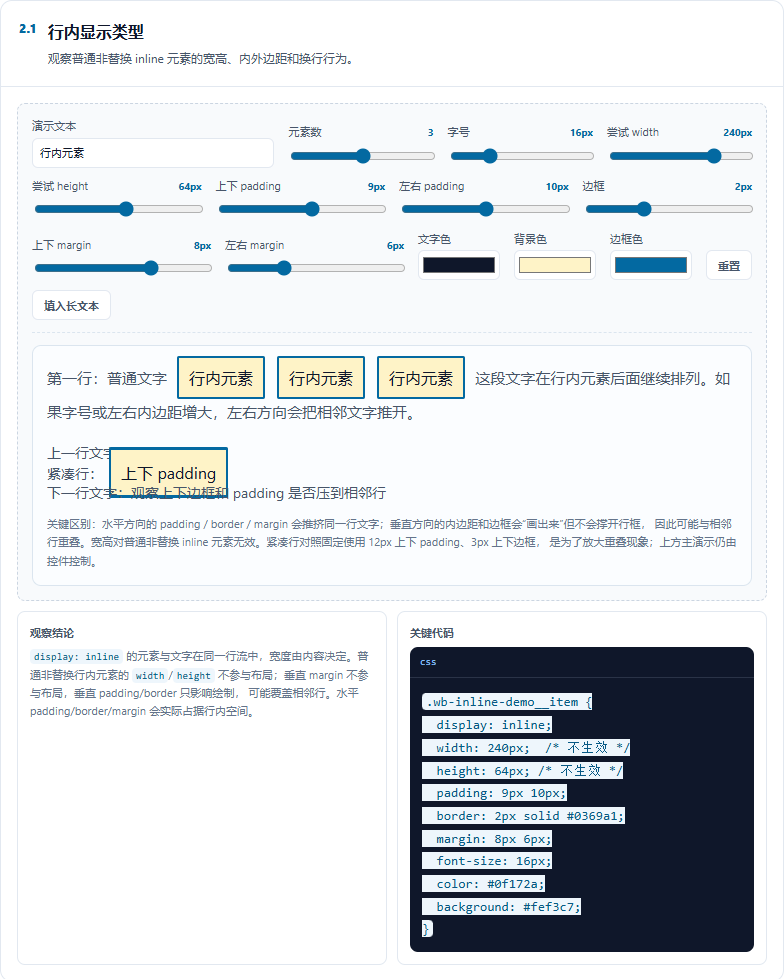

**图2 区块显示类型及相邻 margin 折叠实验**
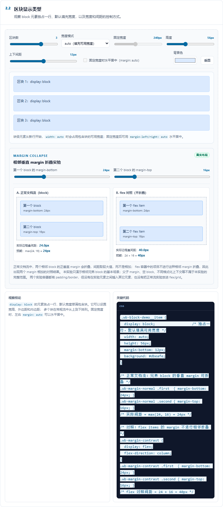

从格式化上下文看，块级格式化上下文（BFC）是一个相对独立的布局环境，内部块级盒的排列不会影响外部；浮动、绝对定位、`overflow` 非 `visible`、`display:flow-root` 等都可能建立 BFC。行内格式化上下文（IFC）则负责行内盒的基线、行高和换行。理解这两个概念后，就更容易解释“为什么给行内元素加垂直 margin 看起来没有把下一行推开”“为什么父元素高度会塌陷”“为什么清除浮动需要 BFC 或 clear”。本项目不把 BFC 当作万能补丁，而是优先用 Flex/Grid 建立明确的一维/二维容器；只有在必须隔离浮动或折叠时，才用 `display:flow-root` 等最小手段。全局 border-box 与统一的间距变量一起，减少了“内容变小但容器不变”与“容器被 padding 撑开”两类常见回归。

## 1.2 布局

常规流是最基础的布局：块级盒在包含块中自上而下排列，行内盒在行内格式化上下文中从左到右排布。`position: static` 不建立新的定位；`relative` 保留原占位，视觉上相对原位置偏移；`absolute` 脱离正常流，参照最近的有效定位祖先的 padding box；`fixed` 通常参照视口，但祖先的 transform/filter/perspective 等可能改变其包含块；`sticky` 保留占位，在滚动祖先内按阈值吸附，并受父容器边界约束。`top/right/bottom/left` 在绝对定位中可同时拉伸元素；固定宽高时，左右偏移的覆盖规则需要结合 `margin:auto` 与实际包含块理解。

Flex 适合一维排列，主轴由 `flex-direction` 决定，`justify-content` 控制主轴分布，`align-items` 控制交叉轴对齐，`gap` 控制项目间距。Grid 适合二维轨道，`grid-template-columns` 与 `grid-template-rows` 定义轨道，`fr` 分配剩余空间，项目可跨列/跨行。浮动在历史上用于多列布局，但需要清除浮动和 BFC 处理；本项目没有用浮动搭建整页，而是用 Flex 构建侧栏+工作区，用 Grid 构建演示与卡片布局，降低清除浮动和高度塌陷的复杂度。

项目 `frontend/src/layout/AppLayout.vue` 以 `.app-shell` 为整体，左侧 `.sidebar`、右侧 `.workspace`；`.workspace` 内是 `.topbar`、`.app-main` 和页脚。主内容宽度限制在可读范围内，侧栏在 980px 以下变成顶部横向导航。`WireframeView.vue` 的 2.18 线框板同样先用 Flex 分系统框架，再用 Grid/Flex 划分页面区域。2.4 的 Flex 演示与 2.5 的 Grid 演示分别验证主轴、交叉轴、`gap`、`fr`、跨列等行为。

**图3 行内区块显示类型**
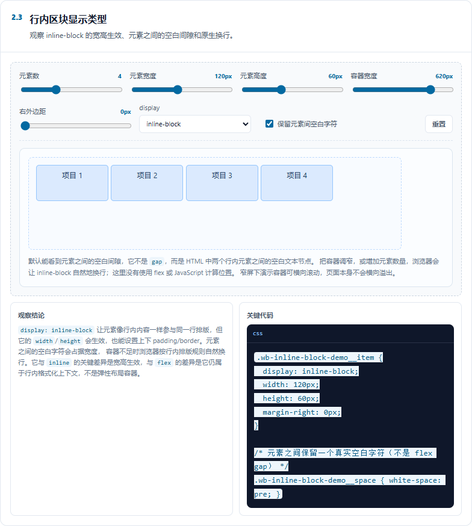

**图4 弹性显示类型**
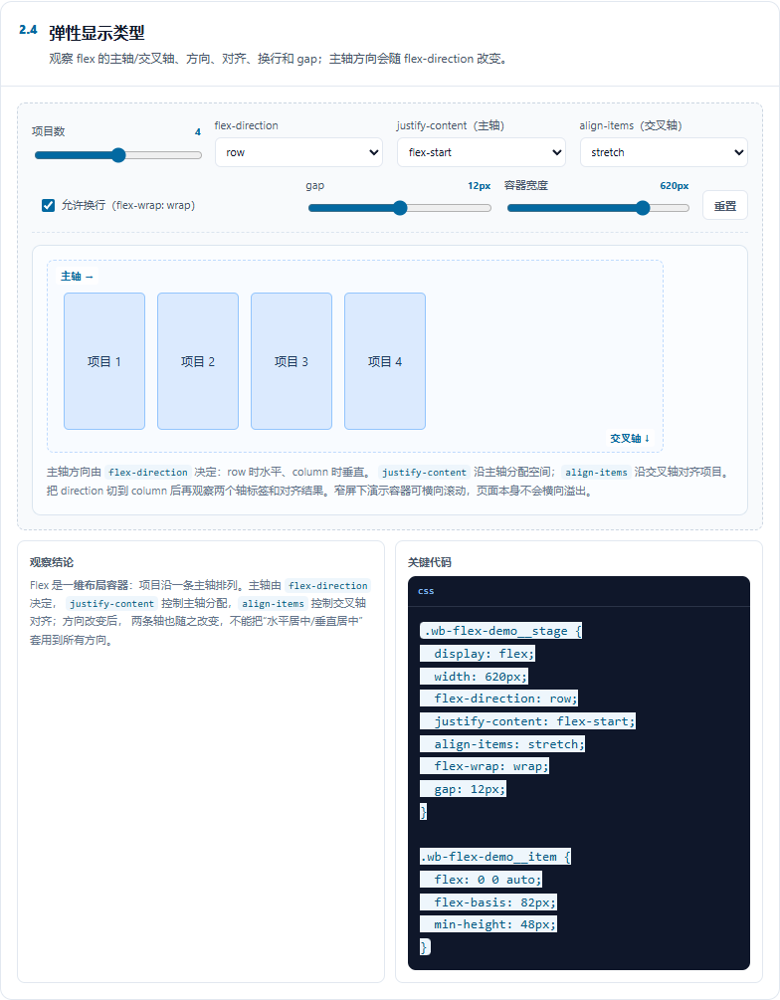

**图5 网格显示类型**
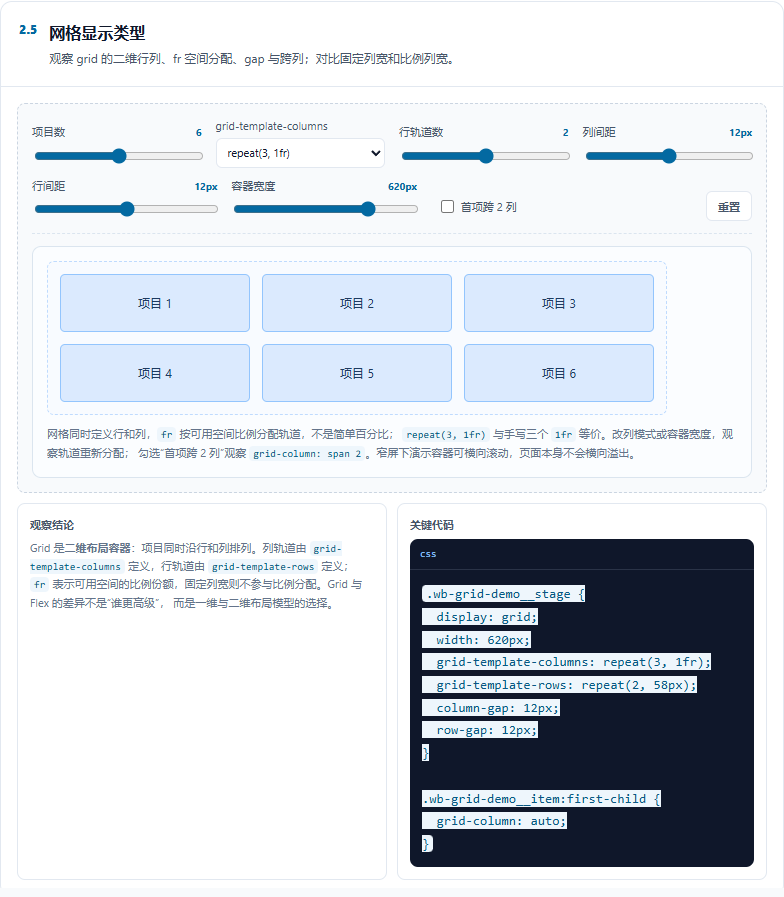

## 1.3 MVC模式

MVC 将模型、视图和控制器分离：Model 负责数据与业务状态，View 负责呈现，Controller 接收请求并协调二者。它与“三层架构”不是同一分类：Controller/Service/Mapper 是后端分层，MVC 是请求处理与界面组织的模式；前后端分离后，Vue 的 View 通过 HTTP 与后端 Controller 交互，Vue 本身不是后端 Controller。

本项目一次保存请求的链路为：Vue 组件收集数据 → `src/api/addresses.ts` 发起请求 → Spring MVC `AddressController` 接收并校验 → `AddressService` 执行业务与事务 → `ExpressAddressMapper` 执行 MyBatis SQL → MySQL → `R{code,message,data}` 返回 → Axios 解包 → Vue 更新界面。解析请求不进入 Mapper：`AddressController.parse` 调用 `AddressParserService`，解析器只做纯文本处理。

分层的优点是职责清楚、Parser 可独立测试、Controller 契约稳定、Service 可复用；代价是文件更多、跨层调用需要设计 DTO/VO、异常需要统一映射。项目通过 `GlobalExceptionHandler`、`R`、`ResultCode`、`Violation` 等公共组件降低重复代码。需要特别说明的是，Vue 组件中的 `ImportView` 不是后端 Controller：它只负责收集输入、调用 API、维护预览行和展示错误；真正的 Controller 是 Spring MVC 的 `AddressController`。把二者混为一谈，会导致“前端路由就是 MVC Controller”“Axios 请求绕过 Service”等错误理解。

**图6 盒模型各部分**
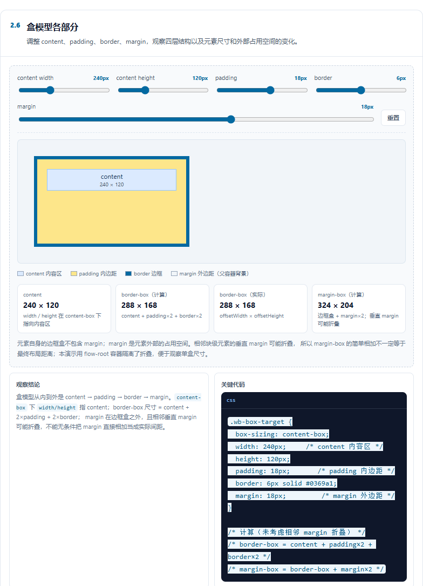

**图7 标准盒模型**
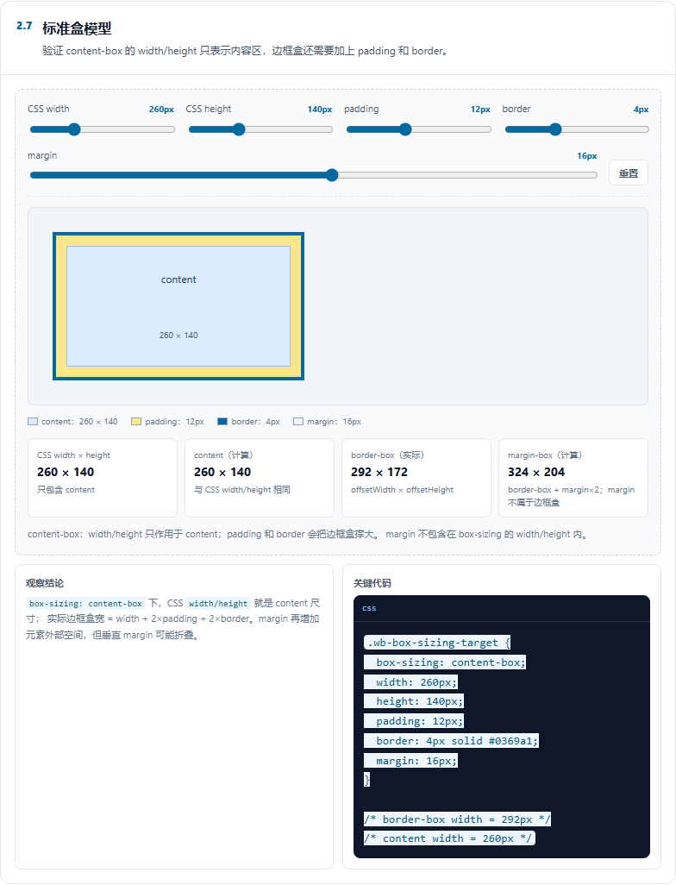

**图8 替代盒模型**
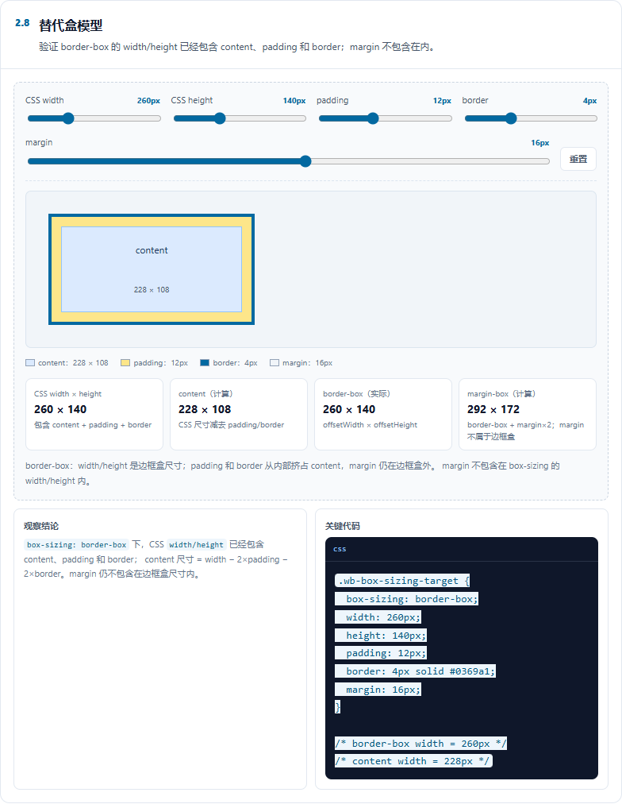

## 1.4 Servlet与请求URI的映射规则

Tomcat 在请求进入 Servlet 之前按 `url-pattern` 选择 Servlet。Servlet 规范的基本顺序是：精确匹配、最长路径前缀匹配、扩展名匹配、默认映射。精确 pattern 只匹配完全相同的路径；路径 pattern（如 `/demo/servlet/*`）把匹配前缀放入 `servletPath`，剩余部分放入 `pathInfo`；扩展名 pattern（如 `*.smap`）按后缀匹配；默认 `/` 通常交给容器的默认 Servlet 或 Spring Boot 的 DispatcherServlet。

Spring Boot 默认把 `DispatcherServlet` 注册在 `/`，所以本项目所有 `/api/**`、`/demo/spring/**` 以及未匹配请求都先进入 DispatcherServlet；Spring MVC 的 `HandlerMapping` 再按 `@GetMapping/@RequestMapping`、HTTP 方法、参数等选择 Controller。这与容器 URL Pattern 是两个层次的规则：容器只看 URL Pattern，方法匹配和 Controller 选择发生在 DispatcherServlet 内部。

项目 `ExpressAddressApplication` 使用 `@ServletComponentScan(basePackages = "com.express.addressbook.servlet")`；三个演示 Servlet 使用 `@WebServlet`：`/demo/servlet/exact`、`/demo/servlet/*`、`*.smap`。`ServletMappingDemoController` 提供 Spring MVC 对照。真实请求证明：精确优先于路径，路径优先于扩展名；`POST` 返回 405 且 `Allow: GET, HEAD, OPTIONS`；`HEAD`、`OPTIONS` 返回 200；未匹配 `/demo/legacy/report.json` 由默认 `/` 进入 DispatcherServlet 后返回 404。详细矩阵见 2.20。

这里需要区分“容器映射顺序”和“Spring 方法匹配”。容器映射只解决“哪个 Servlet 处理这个 URL”，不处理方法；进入 DispatcherServlet 后，Spring 才根据 `@GetMapping`、`@PostMapping`、参数和内容类型选择 Handler。若只写 `@GetMapping` 而用 POST 访问，Spring 抛出 `HttpRequestMethodNotSupportedException`，项目统一处理为 405，并从 `getSupportedHttpMethods()` 动态生成 Allow。若 URL 没有任何 Handler，Spring 返回 404。把 405 写成 404，或把 Spring Handler 说成 Tomcat URL 映射，都是概念错误。

---

# 第2章 实践过程记录

## 2.1 行内显示类型

### 2.1.1 实践内容概述

2.1 使用段落中的真实 `<span>` 观察 inline 元素。普通非替换 inline 元素设置宽高不改变内容盒尺寸；水平 padding、border、margin 会推开同行文字；垂直 padding/border 会绘制到相邻行但不撑开行框；垂直 margin 不参与行框布局。实验改变文本、数量、字号、宽高、内外边距和背景色，以对比“视觉上变大”和“布局上占位”不是同一件事。

### 2.1.2 关键代码片段

来源：`frontend/src/components/basics/InlineDemo.vue`

```css
.wb-inline-demo__text {
  line-height: 1.9;
}
.wb-inline-demo__part {
  display: inline;
  padding: 8px 14px;
  border: 2px solid #2563eb;
  margin: 12px 10px;
  background: #dbeafe;
}
```

### 2.1.3 实践效果图

**图1 行内显示类型**


结论：行内元素的宽高和垂直 margin 不能像块级元素一样理解；需要占位尺寸时应改用 inline-block 或 block。

## 2.2 区块显示类型

### 2.2.1 实践内容概述

2.2 用多个 `<div>` 观察 block 的独占一行、auto 宽度、固定宽度、`margin:auto` 居中和相邻垂直 margin 折叠。MS-06-R1 增加了正常文档流相邻 block 与 flex 对照：前者 24/16 实测 24px，后者实测 40px，证明块级相邻 margin 取较大值、flex item margin 不折叠。

### 2.2.2 关键代码片段

来源：`frontend/src/components/basics/BlockDemo.vue`

```css
.wb-margin-normal { display: block; }
.wb-margin-normal .first  { margin-bottom: 24px; }
.wb-margin-normal .second { margin-top: 16px; }

.wb-margin-contrast {
  display: flex;
  flex-direction: column;
}
.wb-margin-contrast .first  { margin-bottom: 24px; }
.wb-margin-contrast .second { margin-top: 16px; }
```

### 2.2.3 实践效果图

**图2 区块显示类型与 margin collapse 对照**


结论：相邻 block 的正垂直 margin 可折叠为较大值；flex/grid 项目的 margin 不进行这种相邻折叠；不能把所有 margin 都概括为“必然折叠”。

## 2.3 行内区块显示类型

### 2.3.1 实践内容概述

2.3 使用 inline-block 元素观察宽高生效、同行排列、HTML 空白字符间隙和 `vertical-align`。inline-block 仍参与行内格式化上下文，但内部按块级盒计算。

### 2.3.2 关键代码片段

来源：`frontend/src/components/basics/InlineBlockDemo.vue`

```css
.wb-inline-block-item {
  display: inline-block;
  width: 120px;
  height: 64px;
  vertical-align: top;
  border: 1px solid #93c5fd;
  background: #dbeafe;
}
```

### 2.3.3 实践效果图

**图3 行内区块显示类型**


结论：inline-block 既有行内参与又有块级宽高；元素间的换行/空格会产生可见间隙，需要用结构或 `font-size:0` 等方式处理，但不应破坏可读性。

## 2.4 弹性显示类型

### 2.4.1 实践内容概述

2.4 通过 `display:flex` 观察主轴和交叉轴、`flex-direction`、`justify-content`、`align-items`、`flex-wrap`、`flex` 和 `gap`。项目主布局也使用 Flex 实现侧栏与工作区。

### 2.4.2 关键代码片段

来源：`frontend/src/components/basics/FlexDemo.vue`

```css
.wb-flex-stage {
  display: flex;
  flex-direction: row;
  justify-content: space-between;
  align-items: center;
  flex-wrap: wrap;
  gap: 12px;
}
.wb-flex-item {
  flex: 1 1 120px;
}
```

### 2.4.3 实践效果图

**图4 弹性显示类型**


结论：Flex 是一维布局；主轴与交叉轴由方向决定；`gap` 只控制项目间距，不负责外部对齐。

## 2.5 网格显示类型

### 2.5.1 实践内容概述

2.5 使用 `display:grid`、`repeat()`、`1fr`、`gap` 和跨列观察二维轨道。Grid 更适合需要同时控制行与列的区域划分。

### 2.5.2 关键代码片段

来源：`frontend/src/components/basics/GridDemo.vue`

```css
.wb-grid-stage {
  display: grid;
  grid-template-columns: repeat(3, minmax(0, 1fr));
  gap: 10px;
}
.wb-grid-item--span {
  grid-column: span 2;
}
```

### 2.5.3 实践效果图

**图5 网格显示类型**


结论：Grid 适合二维布局；`fr` 分配可用空间，`minmax(0,1fr)` 可避免内容最小宽度撑破轨道；跨列需要明确网格线。

## 2.6 盒模型各部分

### 2.6.1 实践内容概述

2.6 用颜色分层标识 content、padding、border、margin，并读取实际尺寸。通过 `getBoundingClientRect()` 和 `getComputedStyle()` 对照公式，避免把“视觉边框”误当成内容尺寸。

### 2.6.2 关键代码片段

来源：`frontend/src/components/basics/BoxModelDemo.vue`

```css
.wb-box {
  width: 220px;
  padding: 16px;
  border: 6px solid #2563eb;
  margin: 14px;
  background: #dbeafe;
  box-sizing: content-box;
}
```

### 2.6.3 实践效果图

**图6 盒模型各部分**


结论：content、padding、border、margin 的尺寸含义不同；margin 在边框盒外，且相邻垂直 margin 还可能折叠。

## 2.7 标准盒模型

### 2.7.1 实践内容概述

2.7 使用 `box-sizing: content-box`，改变 width、padding、border，观察最终边框盒尺寸按公式增加。项目局部演示使用 content-box，以便把计算过程显式化。

### 2.7.2 关键代码片段

来源：`frontend/src/components/basics/BoxSizingDemo.vue`

```css
.wb-box-content {
  box-sizing: content-box;
  width: 220px;
  padding: 16px;
  border: 4px solid #2563eb;
}
```

### 2.7.3 实践效果图

**图7 标准盒模型**


结论：content-box 的 `width` 不含 padding/border；最终宽度 = width + 左右 padding + 左右 border。

## 2.8 替代盒模型

### 2.8.1 实践内容概述

2.8 使用 `box-sizing: border-box`，保持整体宽度，增加 padding/border 时内容区缩小。项目全局采用 border-box，便于布局稳定。

### 2.8.2 关键代码片段

来源：`frontend/src/components/basics/BoxSizingDemo.vue`

```css
.wb-box-border {
  box-sizing: border-box;
  width: 220px;
  padding: 16px;
  border: 4px solid #2563eb;
}
```

### 2.8.3 实践效果图

**图8 替代盒模型**


结论：border-box 的 `width` 包含 padding/border；内容宽度反算，但 margin 仍在边框盒外。

## 2.9 常规流布局（静态定位）

### 2.9.1 实践内容概述

2.9 观察 `position:static` 下块级与行内元素的排列、前序元素尺寸变化对后续元素的影响。`top/left` 对 static 不产生偏移。

### 2.9.2 关键代码片段

来源：`frontend/src/components/basics/NormalFlowDemo.vue`

```css
.wb-flow-item {
  position: static;
  width: 100%;
  margin-bottom: 10px;
  background: #dbeafe;
}
```

### 2.9.3 实践效果图

**图9 常规流布局**
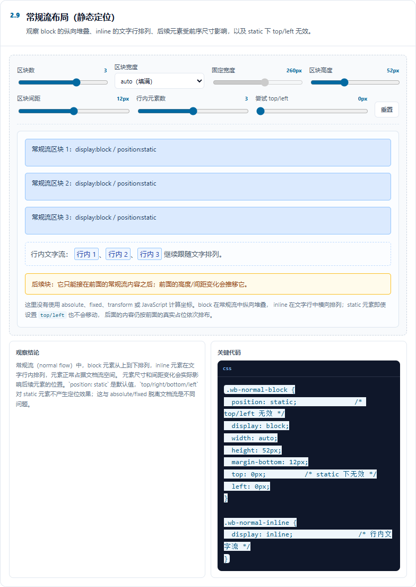

结论：常规流是默认布局；static 元素按文档顺序占位，前序元素高度会推动后续元素。

## 2.10 相对定位

### 2.10.1 实践内容概述

2.10 对同一元素切换 static/relative，观察视觉偏移与原始占位。relative 保留原空间，后续元素仍按原位置排列。

### 2.10.2 关键代码片段

来源：`frontend/src/components/basics/RelativePositionDemo.vue`

```css
.wb-relative-item {
  position: relative;
  top: 18px;
  left: 24px;
  background: #dbeafe;
}
```

### 2.10.3 实践效果图

**图10 相对定位**
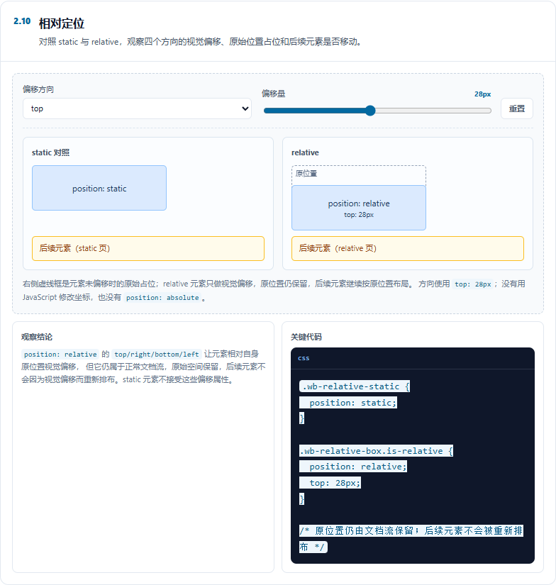

结论：relative 不脱流；偏移只改变绘制位置，原占位保留。

## 2.11 绝对定位

### 2.11.1 实践内容概述

2.11 切换 static/absolute，观察元素脱流、后续元素前移和 `top/right` 偏移。absolute 参照最近有效定位祖先。

### 2.11.2 关键代码片段

来源：`frontend/src/components/basics/AbsolutePositionDemo.vue`

```css
.wb-absolute-item {
  position: absolute;
  top: 16px;
  right: 16px;
  width: 150px;
}
```

### 2.11.3 实践效果图

**图11 绝对定位**
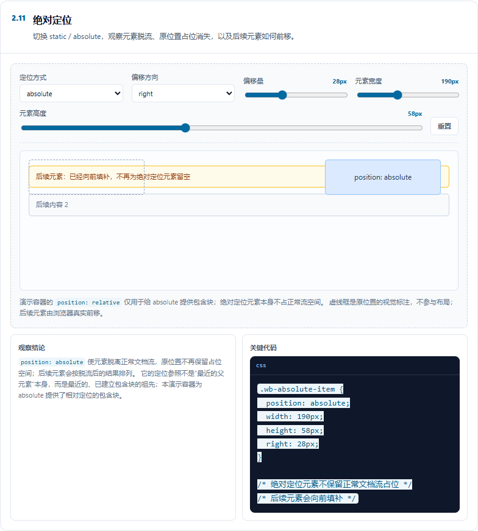

结论：absolute 脱流，原位置不占位；后续元素前移；定位上下文决定偏移参照。

## 2.12 改变绝对定位的定位上下文

### 2.12.1 实践内容概述

2.12 固定子元素的 absolute，切换父元素的 static/relative，观察子元素相对外层或父层定位。

### 2.12.2 关键代码片段

来源：`frontend/src/components/basics/PositioningContextDemo.vue`

```css
.wb-context-parent { position: relative; }
.wb-context-child {
  position: absolute;
  top: 24px;
  left: 24px;
}
```

### 2.12.3 实践效果图

**图12 绝对定位上下文**
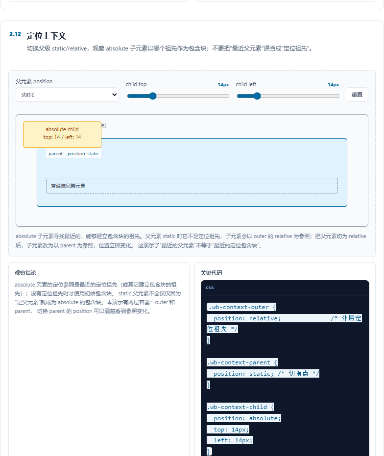

结论：包含块由最近的有效定位祖先决定；普通父元素不会因为“在 DOM 里包着子元素”就自动成为绝对定位参照。

## 2.13 固定定位

### 2.13.1 实践内容概述

2.13 用 fixed 徽标和 absolute 对照滚动行为，观察 fixed 相对视口。徽标只在 2.13 区域进入视口时显示，避免影响其他章节。

### 2.13.2 关键代码片段

来源：`frontend/src/components/basics/FixedPositionDemo.vue`

```css
.wb-fixed-probe {
  position: fixed;
  right: 18px;
  bottom: 18px;
  z-index: 30;
}
```

### 2.13.3 实践效果图

**图13 固定定位**
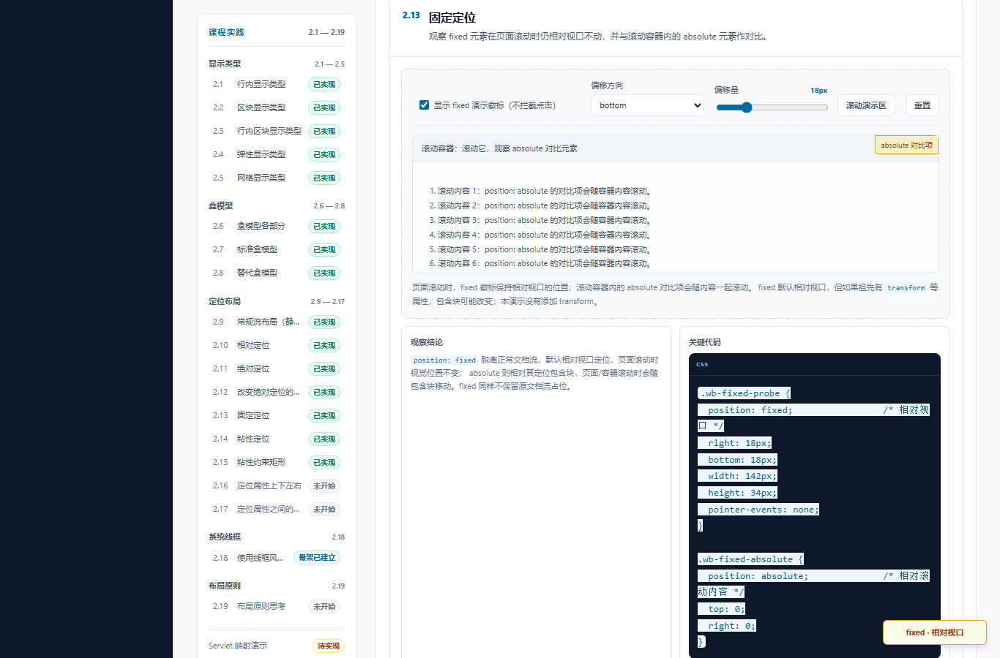

结论：fixed 通常以视口为参照；transform 等祖先可能改变包含块，不能把“fixed 永远相对视口”绝对化。

## 2.14 粘性定位

### 2.14.1 实践内容概述

2.14 在真实滚动容器中观察 sticky 的阈值、吸附和回到常规流。没有足够滚动空间时，sticky 不会产生持续吸附。

### 2.14.2 关键代码片段

来源：`frontend/src/components/basics/StickyPositionDemo.vue`

```css
.wb-sticky-item {
  position: sticky;
  top: 0;
  background: #dbeafe;
}
```

### 2.14.3 实践效果图

**图14 粘性定位**
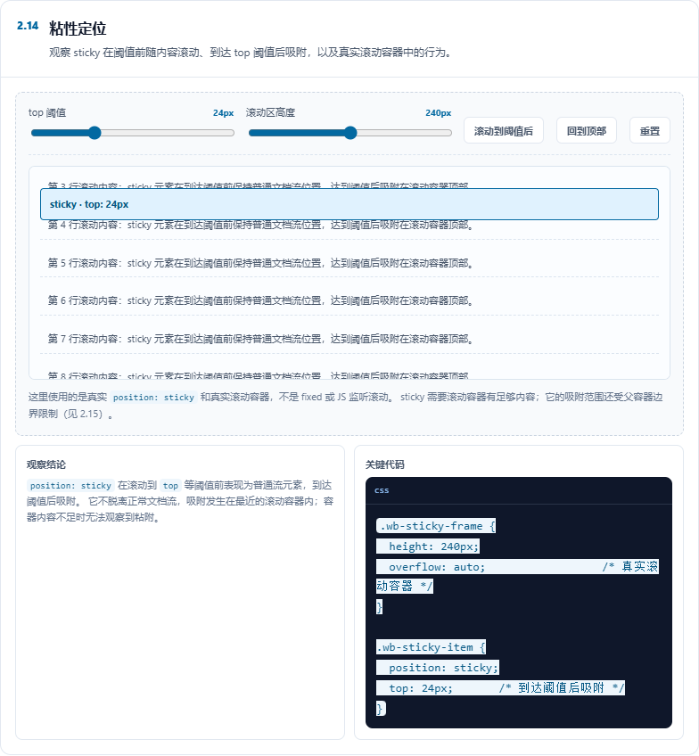

结论：sticky 保留占位；在滚动阈值内吸附；受滚动容器与父容器边界约束。

## 2.15 粘性约束矩形

### 2.15.1 实践内容概述

2.15 使用长内容与短父容器观察 sticky 的约束边界，并补充五定位方式对比表。父容器的 padding/border/尺寸决定粘性可移动范围。

### 2.15.2 关键代码片段

来源：`frontend/src/components/basics/StickyConstraintDemo.vue`

```css
.wb-sticky-constraint {
  position: sticky;
  top: 0;
}
.wb-constraint-parent {
  height: 190px;
  /* 不能设置 overflow:hidden，否则会意外创建滚动容器 */
}
```

### 2.15.3 实践效果图

**图15 粘性约束矩形**
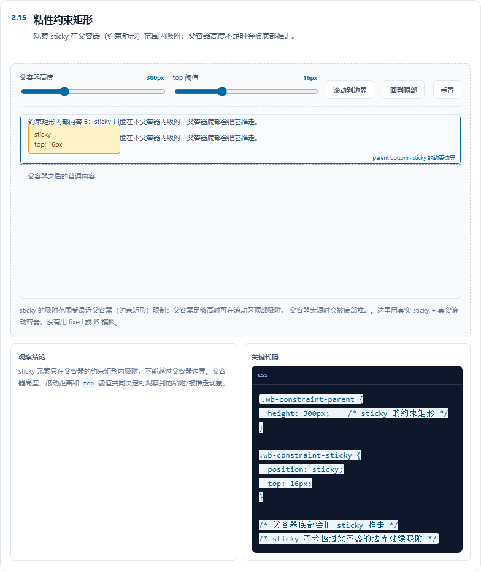

结论：sticky 的“粘性约束矩形”不是视口本身，而是滚动容器与父级边界共同限定的区域；错误的 overflow 会改变滚动容器。

## 2.16 定位属性上下左右

### 2.16.1 实践内容概述

2.16 对 static/relative/absolute 切换 top/right/bottom/left，展示四方向偏移和参照差异。

### 2.16.2 关键代码片段

来源：`frontend/src/components/basics/OffsetPropertiesDemo.vue`

```css
.wb-offset-item {
  position: absolute;
  top: 16px;
  right: 20px;
  bottom: 16px;
  left: 20px;
}
```

### 2.16.3 实践效果图

**图16 定位偏移**
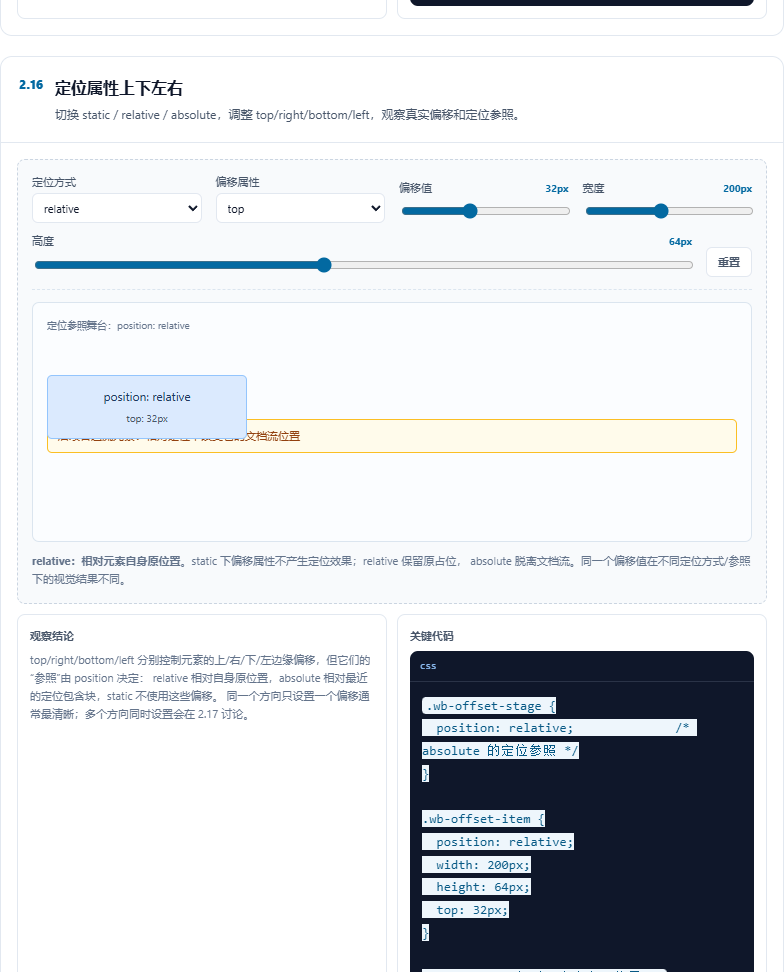

结论：四方向偏移在不同定位方式下含义不同；绝对定位同时设置上下/左右可拉伸。

## 2.17 定位属性之间的覆盖影响

### 2.17.1 实践内容概述

2.17 观察 left/right 同时设置、固定宽度与 `margin:auto`、absolute 的覆盖关系；补充 z-index/堆叠上下文实验。

### 2.17.2 关键代码片段

来源：`frontend/src/components/basics/OffsetConflictDemo.vue`、`StackingContextDemo.vue`

```css
.wb-conflict-item {
  position: absolute;
  left: 20px;
  right: 20px;
  margin: 0 auto;
  width: 160px;
}
.wb-stack-layer {
  position: absolute;
  z-index: 2;
}
```

### 2.17.3 实践效果图

**图17 定位覆盖**
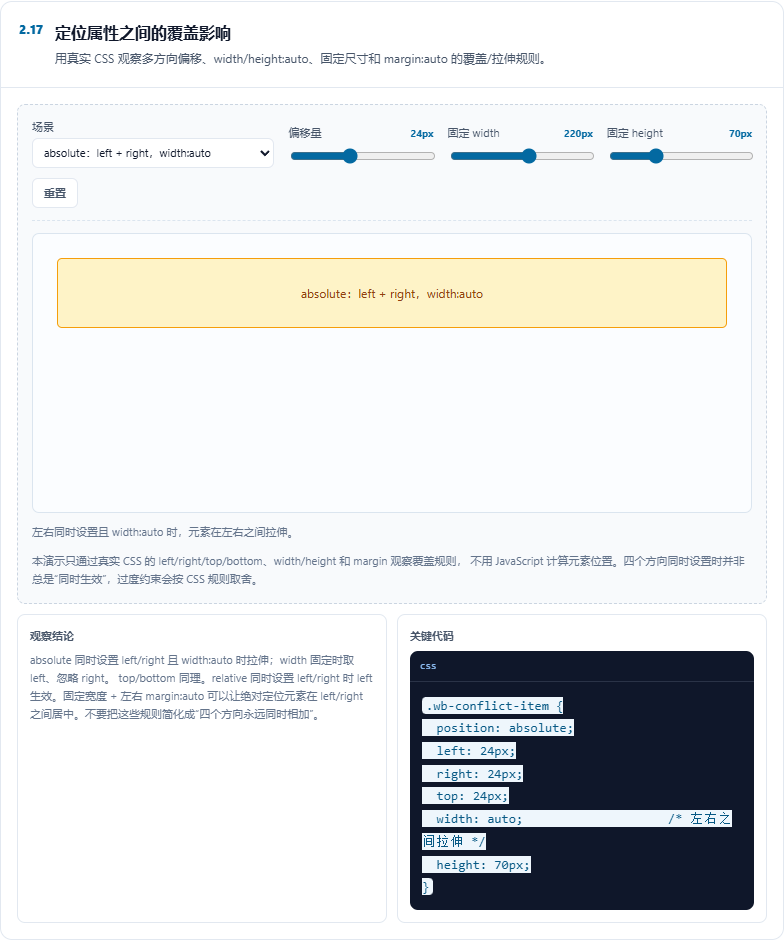

结论：同时设置相反方向偏移会产生覆盖/拉伸；`margin:auto` 在固定尺寸下可参与居中；z-index 只在同一堆叠上下文内可比较，不能简单断言“数值大就覆盖所有元素”。

## 2.18 使用线框风格仿制XXX网页的布局

### 2.18.1 实践内容概述

课程附录4给出了湖北工程学院新技术学院首页参考图（图18，来源：课程任务书附录4）。本项目经负责人批准，不复制该外部网页的 Logo、Banner、图片、字体或业务内容；2.18 以快递通自身页面结构为对象完成原创低线框：顶部系统栏、左侧导航、主内容、页面标题与操作区，以及智能录入页和地址簿页的区域划分。之后用 `WireframeView.vue` 的 Plan 模式展示线框，用 Implemented 模式展示真实 AppLayout + 真实页面组件。该范围调整已在项目文档中记录，不能把本项目写成“已完成外部网页仿制”。

线框稿的价值在于先解决“信息放在哪里”，再解决“视觉怎么做”。本项目的线框用灰块和红框表示区域，不引入真实图片和品牌素材；实现阶段才用 AppLayout、卡片、表格和按钮替换灰块。与参考网页对比，二者都采用顶部信息区、主导航、内容区、底部信息的基本层级，但本项目没有复制其 Banner、新闻列表或学校品牌，而是把同样的“层级思维”用于快递地址录入。差异必须在论文中明确，否则会把参考图误认为项目实现。

### 2.18.2 关键代码片段

来源：`frontend/src/views/WireframeView.vue`

```vue
<div class="wb-plan-page" data-testid="plan-import-page">
  <div class="wb-plan-page__head">
    <strong>批量地址录入</strong>
  </div>
  <div class="wb-plan-workflow">
    <span>01 粘贴原文</span><span>02 智能识别</span>
    <span>03 人工核对</span><span>04 确认保存</span>
  </div>
</div>
```

### 2.18.3 实践效果图

**图18 原网页参考图（来源：课程任务书附录4，不是本项目实现）**


**图19 原创线框稿**
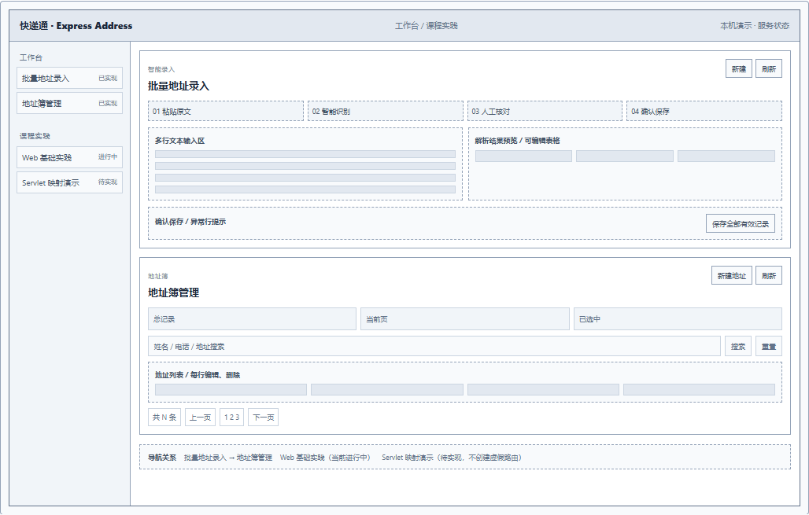

**图20 当前项目实现效果**


结论：线框稿只表达结构、层级、对齐和主要操作；真实页面验证布局可落地。与参考网页相比，本项目的品牌、导航、字段和业务内容均来自快递通，不照搬外部网页。

## 2.19 布局原则思考

### 2.19.1 实践内容概述

2.19 用真实 AppLayout 的 `.topbar`、`.sidebar`、`.app-main` 三区域高亮，配合尺寸测量和 1366/980/760/390 响应式观察布局原则。高亮使用 outline，不改变盒模型，不阻挡操作。

### 2.19.2 关键代码片段

来源：`frontend/src/components/basics/LayoutPrinciplesDemo.vue`

```css
.app-shell.wb-layout-highlight .topbar {
  outline: 3px solid #0ea5e9;
  outline-offset: -3px;
}
.app-shell.wb-layout-highlight .sidebar {
  outline: 3px solid #f59e0b;
  outline-offset: -3px;
}
.app-shell.wb-layout-highlight .app-main {
  outline: 3px solid #10b981;
  outline-offset: -3px;
}
```

### 2.19.3 实践效果图

**图21 真实 AppLayout 三区域高亮**


结论：页面应按“系统栏、导航、主内容”划分；优先使用常规流 + Flex/Grid，不用绝对定位搭整页；间距使用统一尺度；组件化和命名边界比单页堆叠更利于维护；窄屏时导航策略必须按真实实现说明。

2.19 的重点不是给出几条口号，而是把“结构、容器、层级、响应式”落到可验证的选择。以 AppLayout 为例，顶栏与底部状态栏提供全局上下文，侧栏承载一级导航，主内容只负责当前页面；这样页面组件不需要重复实现导航。间距用统一的 4/8 倍数尺度，但不是机械地把所有值都改成 8 的倍数；在文字行高、图标与文字之间仍需要微调。z-index 只用于顶栏、对话框、浮层等有限层级，不为每个卡片编号。响应式上，1366 保持完整侧栏，980 以下切换布局，390 下优先保证表单可操作和表格内部滚动，而不是把整个页面缩成不可读的一列。

## 2.20 Servlet与请求URI的映射规则

### 2.20.1 实践内容概述

2.20 用三个真实 `@WebServlet` 和一个 Spring MVC 对照 Controller 展示容器映射与 Spring Handler 映射的区别。真实请求矩阵包括精确、精确不完全匹配、路径、多级路径、扩展名、路径/扩展名冲突、Spring 对照、405、404、查询参数、HEAD/OPTIONS。项目用 `@ServletComponentScan` 启用注解扫描；`DispatcherServlet` 仍使用默认 `/`，没有新增默认 Servlet。

### 2.20.2 关键代码片段

来源：`backend/src/main/java/com/express/addressbook/servlet/MappingDemoServletSupport.java`

```java
@Override
protected void service(HttpServletRequest request, HttpServletResponse response)
        throws ServletException, IOException {
    String method = request.getMethod();
    if (!"GET".equals(method) && !"HEAD".equals(method) && !"OPTIONS".equals(method)) {
        response.setHeader("Allow", "GET, HEAD, OPTIONS");
        response.sendError(HttpServletResponse.SC_METHOD_NOT_ALLOWED,
                method + " is not supported by this demo Servlet");
        return;
    }
    super.service(request, response);
}
```

### 2.20.3 实践效果图

**图22 Servlet 演示页真实请求**
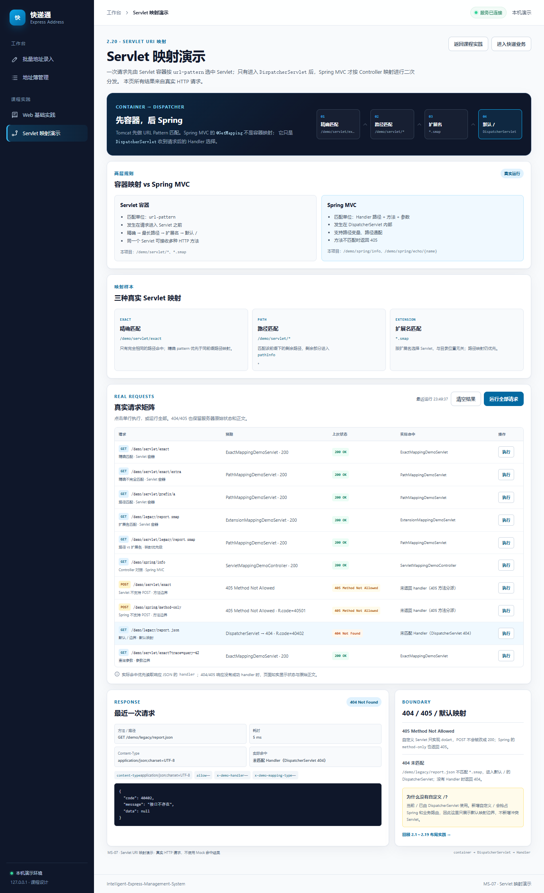

**图23 容器映射与 Spring MVC 分层示意（依据真实架构自绘，不是运行截图）**
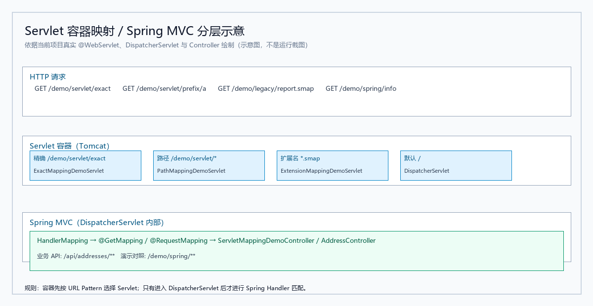

**表6 Servlet 映射实测矩阵**

| 请求 | 预期命中 | 实际命中 | servletPath | pathInfo | 状态 |
| --- | --- | --- | --- | --- | ---: |
| GET /demo/servlet/exact | Exact | ExactMappingDemoServlet | /demo/servlet/exact | null | 200 |
| GET /demo/servlet/exact/extra | Path | PathMappingDemoServlet | /demo/servlet | /exact/extra | 200 |
| GET /demo/servlet/prefix/a | Path | PathMappingDemoServlet | /demo/servlet | /prefix/a | 200 |
| GET /demo/legacy/report.smap | Extension | ExtensionMappingDemoServlet | 完整路径 | null | 200 |
| GET /demo/servlet/legacy/report.smap | Path | PathMappingDemoServlet | /demo/servlet | /legacy/report.smap | 200 |
| GET /demo/spring/info | Spring | ServletMappingDemoController | — | — | 200 |
| POST /demo/servlet/exact | 405 | HttpServlet 分派拒绝 | — | — | 405 |
| HEAD /demo/servlet/exact | 200 | ExactMappingDemoServlet | /demo/servlet/exact | null | 200 |
| OPTIONS /demo/servlet/exact | 200 | HttpServlet | — | — | 200 |
| GET /demo/legacy/report.json | Dispatcher 404 | 无 Handler | — | — | 404 |

结论：容器先按 URL Pattern 选 Servlet；Spring MVC 只是 DispatcherServlet 内部二次匹配。`OPTIONS` 的 Allow 不能错误广告未实现的 POST；`Allow` 必须反映真实支持的方法。

2.20 的真实矩阵还说明“404 与 405 不是同一类错误”。路径存在但方法不支持时是 405，响应应带 Allow；路径本身未映射时是 404。项目最初的实现中，Servlet 405 没有 Allow，且自定义 `doPost` 覆写让 `doOptions` 错误广告 POST；R1 修复后改为在 `service` 边界拦截非 GET/HEAD/OPTIONS，并动态补充 Spring 的 HEAD/OPTIONS。这个修复没有改变 GET 或映射优先级，却让 HTTP 语义与真实能力一致，也说明“能通过页面测试”不代表协议头正确。

## 2.21 快递地址簿录入程序设计

### 2.21.1 需求与用例

系统面向“多行联系人文本快速录入”场景。主要用例：粘贴多行文本、识别、查看有效/无效行、人工修改、打开保存确认、确认保存、地址簿列表、搜索、分页、新建、编辑、单条删除、当前页批量删除。系统不包含登录/注册/角色权限，这是课程任务（一）之外的既定范围，不能宣称已实现身份认证。

用例之间的边界也需要明确：识别是只读操作，不创建地址；保存是独立命令，必须在用户确认后执行；列表的搜索是只读查询；删除是逻辑删除，不物理清除历史数据。批量删除限定“当前页已选行”，不是“全库匹配条件删除”，界面上必须让用户看到这一点。系统没有“自动补全地址”“智能推荐电话”等能力；输入解析失败时保留原始行，允许人工修正，这是比“自动猜测”更诚实的设计。

### 2.21.2 概要设计

前后端分离：Vue 3 前端负责录入、预览、列表、弹窗和课程实践页；Spring Boot 后端提供 `/api/addresses/**` 与 `/demo/**`；Parser 是独立纯逻辑包；Controller → Service → Mapper 分层；前端 API 层统一走 Axios；Web 实践页和 Servlet 演示页与业务数据解耦。AppLayout 提供顶栏、侧栏和主内容。

从依赖方向看，前端只依赖 HTTP 契约与类型定义，不依赖 Java 类；后端 Controller 依赖 Service，Service 依赖 Mapper 与 Parser，Parser 不反向依赖 Web 或数据库。这样的依赖方向使 Parser 可以在普通单元测试中直接构造输入，不需要启动 Spring 或 MySQL；也使地址簿页和录入页可以共享 API 封装，而不是各自拼接 URL。代价是 DTO/VO 需要同步维护，接口字段变更必须同时修改前后端类型；项目通过 `docs/api-design.md`、TypeScript 类型和集成测试降低漂移风险。

**表1 开发环境与工具版本**

| 项 | 版本/说明 |
| --- | --- |
| JDK | Java 17 |
| 后端 | Spring Boot 3.3.5、Spring MVC |
| 持久层 | MyBatis-Plus 3.5.7 |
| 数据库 | MySQL 8.0.43，InnoDB，utf8mb4 |
| 前端 | Vue 3、TypeScript、Vite、Element Plus、Axios、Vue Router |
| 测试 | JUnit 5、Maven、Playwright、Chrome、Edge |

**表2 前后端技术选型**

| 层 | 选择 | 理由 |
| --- | --- | --- |
| 前端视图 | Vue 3 + Element Plus | 组件化、表单/表格/对话框成熟 |
| 状态与请求 | Composition API + Axios | 轻量、与 TypeScript 配合 |
| 后端 | Spring Boot + Spring MVC | 统一 REST/异常/校验 |
| 持久层 | MyBatis-Plus | 单表 CRUD、分页、逻辑删除 |
| 测试 | JUnit/Playwright | 后端分层与真实浏览器证据 |

### 2.21.3 数据库设计

**表3 `express_address` 字段**

| 字段 | 类型 | 约束/说明 |
| --- | --- | --- |
| id | BIGINT | PK，自增；前端按 String 处理 |
| receiver_name | VARCHAR(50) | 1～50 个 Unicode 码点 |
| phone | VARCHAR(20) | 规范化电话 |
| full_address | VARCHAR(255) | 保留地址内部标点和原文 |
| create_time | DATETIME | 默认当前时间 |
| update_time | DATETIME | 更新自动刷新 |
| is_deleted | TINYINT | 0/1 逻辑删除 |

索引：`(is_deleted, create_time)` 支撑列表排序/过滤；`phone` 支撑电话搜索。使用 utf8mb4；不拆分省、市、区，因为课程任务重点在完整地址保真和解析，而不是行政区划标准化。正式业务库为 `express_address_book`；MS-08 性能/集成使用隔离 Schema `express_address_book_ms08_test`，不能把测试 Schema 写成正式库。root 只用于本机课程演示，密码通过环境变量或未跟踪的本地配置提供；不创建 `root@'%'`。

不拆分省市区还有一个工程原因：用户的原始地址可能包含“西湖区”“余杭区”“XX 街道”等不同粒度，强拆会把无法识别的片段塞进错误字段，反而破坏“完整地址保真”。在需要地址标准化的生产系统中，应引入行政区划库和人工确认流程；本项目明确没有做这件事，不能把自由文本字段包装成“标准地址”。逻辑删除字段 `is_deleted` 使用 MyBatis-Plus 逻辑删除配置，普通查询自动过滤已删除记录；这避免物理删除对历史数据造成不可逆影响，但测试数据清理仍需明确范围，不能借逻辑删除之名清理主库。

### 2.21.4 接口设计

**表4 REST 接口清单**

| 方法 | URI | 功能 | 主要响应 |
| --- | --- | --- | --- |
| POST | /api/addresses/parse | 解析多行文本 | ParseResult |
| GET | /api/addresses | 分页/关键词查询 | PageResult |
| GET | /api/addresses/{id} | 查询单条 | AddressVO |
| POST | /api/addresses | 新建 | id |
| PUT | /api/addresses/{id} | 编辑 | id |
| DELETE | /api/addresses/{id} | 单条逻辑删除 | R.ok |
| POST | /api/addresses/batch | 批量保存 | savedCount/ids |
| POST | /api/addresses/batch-delete | 批量删除 | deletedCount |

统一响应 `{code,message,data}`。字段/参数错误 40001，集合/文本数量超限 40003；`data.violations[]` 用于请求字段错误，`data.items[].errors[]` 用于解析行错误，不能混用。ID 输出为字符串，分页字段为 Number；批量保存最多 200 条，201 条拒绝；批量保存整批事务。

接口设计中最容易混淆的是 40001 与 40003：前者是“某字段本身不合法”，例如姓名为空、电话格式错误；后者是“数量/长度超过接口上限”，例如 rawText 超过 20000 字符、有效行超过 200、批量保存超过 200 条。解析行内的 E102～E111 不是 HTTP 40001，而是 `items[].errors[]` 中的业务错误；两者层级不同。批量保存的 DTO 还包含嵌套元素校验，外层 `@Valid` 必须配合 `List<@Valid AddressSaveDTO>`，否则元素内部约束可能不执行。项目在 Controller 与服务层都保留数量/空元素检查，避免只依赖前端。

### 2.21.5 地址解析设计

解析器遵循 PR-01～PR-13：去 BOM、统一换行、按物理行切分、跳过空行但保留行号；定位电话；提取姓名；从原串删除姓名/电话区间，保留地址内部标点；1～50 个 Unicode 码点；单字姓名可用；地址上限 255；单行 500 字符；单次 20000 字符/200 有效行。错误码 E102～E108、E110、E111；**E109 已删除且不得重新引入**。E106 表示 1～50 码点内存在非法字符，E111 表示超过 50。

**表5 解析规则与错误码（节选）**

| 规则/错误码 | 含义 |
| --- | --- |
| PR-01/02 | BOM、换行、空行、原始行号 |
| PR-03 | 电话定位与规范化 |
| PR-05 | 从原文剔除姓名/电话，保留地址 |
| PR-07 | 姓名 1～50 Unicode 码点 |
| E102 | 未识别姓名 |
| E103 | 未识别电话 |
| E104/E108 | 电话格式错误/超长 |
| E105 | 缺少地址 |
| E106/E111 | 姓名非法字符/超长 |
| E110 | 单行超 500 字符 |

真实示例：`菜小鸟，13800138000，浙江省杭州市西湖区湖滨小区12栋301室` 可解析为姓名菜小鸟、电话 13800138000、地址保真；`张三，13900139000，浙江省杭州市余杭区文一西路100号` 同样有效；`只有姓名没有电话` 进入待修正，包含 E103/E102/E105 等错误。

姓名与地址的歧义是最难规则化的部分。例如“张三 13800138000 浙江省……”中，姓名候选必须排除地址词；而“Room 301，13800138000，杭州市……”中，Room 可能是地址前缀而不是姓名。项目采用有限启发式：优先选择合法姓名候选、保留原始地址字符串、允许人工修正，而不是追求 100% 自动识别。这个取舍让错误可解释、可恢复；如果把不确定的候选强行删掉，反而会造成地址缺字。电话定位也有类似问题：地址内部括号不应被误删，只有确定成对的包裹符才随电话删除。

### 2.21.6 解析与保存分离的实现

解析 API 只调用 Parser，不写数据库；保存 API 独立执行。Parser 包不依赖 Mapper/JDBC/MyBatis-Plus/IO。前端只把有效/已修正行放入 `toPayload`；INVALID 行不进入保存请求。后端保存阶段再次校验，批量保存用 `@Transactional(rollbackFor = Exception.class)`，任一条失败整批回滚。LikeEscaper 按 `!`→`!!`、`%`→`!%`、`_`→`!_` 顺序转义，SQL 使用 `ESCAPE '!'`，保证 `%`、`_` 按字面搜索。

这种分离带来两个直接好处：第一，解析可以在没有数据库连接的页面中完成，预览、人工修改、保存确认都不产生写操作；第二，保存事务的范围明确，只有用户确认后的批量插入进入事务。若把解析和保存放在同一个接口，解析失败或预览阶段就可能产生半写入，或者用户取消时仍留下数据。项目选择“两次请求”而不是“一个接口包办”，代价是前端需要维护原始快照和提交载荷，但换来了可回滚、可审计的边界。LIKE 转义则解决另一个隐蔽问题：用户搜索 `%` 时，未转义会匹配所有记录；只有转义并显式 `ESCAPE '!'` 才能按字面查询。

### 2.21.7 关键实现过程

关键实现过程按“输入→解析→展示→保存”的顺序组织：先保留物理行号和原文，再定位电话与姓名，合并删除区间得到地址；随后用 LikeEscaper 保护查询；前端用 original 快照计算修改状态，用保存确认弹窗明确提交数量；最后用事务和二次校验保证批量写入的一致性。下面的代码片段均来自当前仓库；为了篇幅只保留与论点直接相关的行，省略处不改变语义。

**片段1：行号保留**（来源：`LineSplitter.java`）

```java
text = text.replace("\r\n", "\n").replace('\r', '\n');
String[] rawLines = text.split("\n", -1);
for (int i = 0; i < rawLines.length; i++) {
    if (TextSegments.isBlank(rawLines[i])) { skipped++; continue; }
    lines.add(new Line(i + 1, rawLines[i]));
}
```

**片段2：电话定位**（来源：`PhoneExtractor.java`）

```java
PhoneMatch found = findFirst(matchCopy, PhonePatterns.MOBILE);
if (found == null) found = findFirst(matchCopy, PhonePatterns.MASKED_MOBILE);
if (found == null) found = findFirst(matchCopy, PhonePatterns.LANDLINE);
```

**片段3：地址原串剔除**（来源：`AddressExtractor.java`）

```java
ranges.add(new int[]{name.start(), name.end()});
ranges.add(new int[]{phone.start(), phone.end()});
ranges.sort(Comparator.comparingInt(range -> range[0]));
// 合并区间后按原串拼接剩余内容，只 trim 边界，不改写内部标点
```

**片段4：LIKE 转义**（来源：`LikeEscaper.java`）

```java
return value.replace("!", "!!")
        .replace("%", "!%")
        .replace("_", "!_");
```

**片段5：批量保存事务**（来源：`backend/src/main/java/com/express/addressbook/service/AddressService.java`）

```java
@Transactional(rollbackFor = Exception.class)
public BatchSaveResult batchSave(List<AddressSaveDTO> items) {
    if (items == null || items.isEmpty()) {
        throw badRequest("items", "没有可保存的记录");
    }
    if (items.size() > 200) {
        throw limitExceeded("items", "单次最多保存 200 条");
    }
    List<Long> ids = new ArrayList<>(items.size());
    for (AddressSaveDTO dto : items) {
        ExpressAddress entity = toEntity(dto);
        if (mapper.insert(entity) != 1) {
            throw databaseError();
        }
        ids.add(entity.getId());
    }
    return new BatchSaveResult(ids.size(), ids);
}
```

**片段6：前端 original 快照、isRowEdited 与 toPayload**（来源：`frontend/src/utils/addressPayload.ts`）

```ts
export function toPayload(row: ParsedRow): AddressSavePayload {
  return {
    receiverName: row.receiverName.trim(),
    phone: row.phone.trim(),
    fullAddress: row.fullAddress.trim(),
    lineNo: row.lineNo
  }
}

export function isRowEdited(row: ParsedRow): boolean {
  return row.receiverName !== row.original.receiverName
    || row.phone !== row.original.phone
    || row.fullAddress !== row.original.fullAddress
}
```

**片段7：保存确认**（来源：`frontend/src/components/import/SaveConfirmDialog.vue`）

```vue
<el-dialog :model-value="modelValue" width="min(720px, calc(100vw - 32px))">
  <template #header>
    <h3>确认保存地址</h3>
    <p>请确认提交数量与异常行；无效记录不会进入保存请求。</p>
  </template>
  <div class="dialog-summary">
    <span>有效记录</span><strong>{{ submitRows.length }}</strong>
    <span>人工修改</span><strong>{{ editedCount }}</strong>
    <span>原解析 INVALID</span><strong>{{ invalidParsedCount }}</strong>
  </div>
  <div class="submit-count">实际提交 <strong>{{ submitRows.length }}</strong> 条</div>
  <el-button data-testid="confirm-save" @click="emit('confirm')">确认保存</el-button>
</el-dialog>
```

### 2.21.8 界面效果

界面截图只使用虚构联系人、脱敏电话和虚构地址。录入页的视觉层级依次是：页面标题与统计、四步流程、粘贴区、解析统计、核对表、保存条；核对表同时展示原始值、当前值、字段长度和错误信息，避免用户只看到“失败”却不知道该改哪里。保存确认弹窗把“有效记录、人工修改、原解析 INVALID、待修正行、实际提交”分开显示，防止把未修正行混入提交。

**图24 智能录入页**


**图25 解析后的结构化结果**
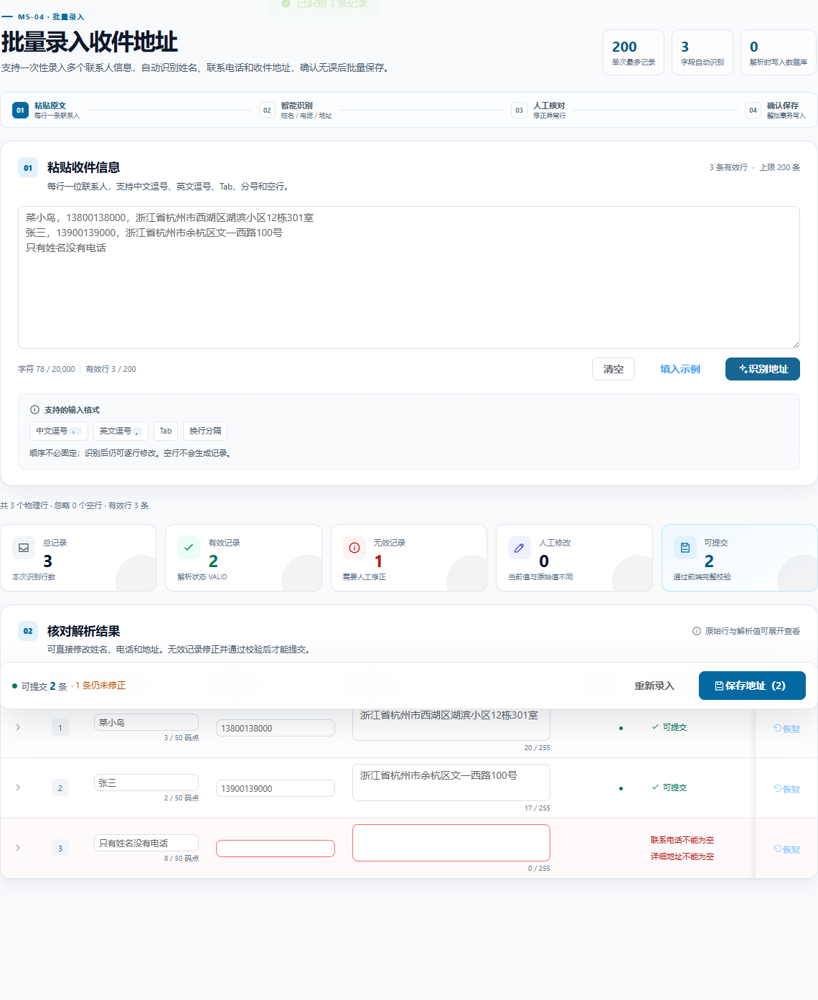

**图26 人工修改与保存确认弹窗**


**图27 地址簿列表与操作入口**


地址列表展示总数、当前页数量、搜索、刷新和当前页批量操作入口；每条记录提供编辑和删除操作，数据使用 `MSDEMO` 虚构记录。

**图28 地址信息编辑弹窗**
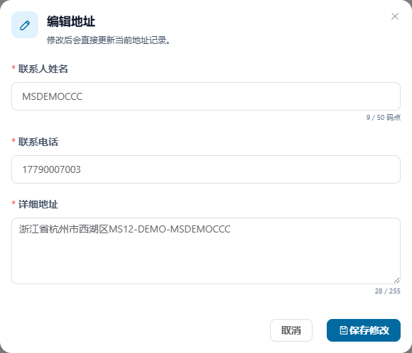

编辑弹窗回显当前记录的姓名、电话和地址，底部提供取消与保存修改，修改对象仅为本轮演示记录。

**图29 单条地址删除确认**
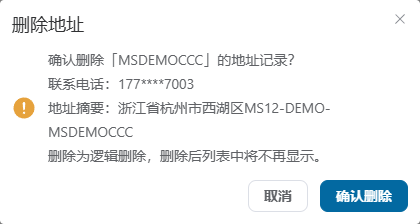

单条删除前显示记录姓名、脱敏电话和地址摘要，并明确说明是逻辑删除；确认后才调用删除接口。

**图30 当前页多条地址批量删除确认**
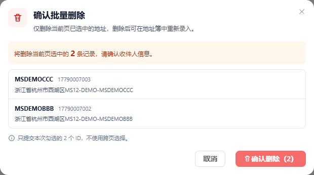

批量删除只针对当前页已勾选的两条本轮演示记录，弹窗明确提示“仅删除当前页已选中的地址”，并列出待删除记录，不能描述为全库批量删除。

**图31 Maven 测试记录（由实际日志整理为报告截图，不是伪造终端）**
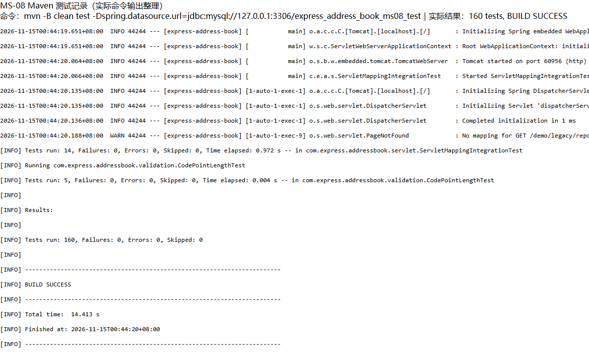

### 2.21.9 测试与结果

**表7 测试执行摘要**

测试组织按“纯逻辑→契约→真实 HTTP→数据库→浏览器”逐层展开：Parser 单测验证分隔符、电话、姓名、地址保真和错误码；MockMvc 验证 HTTP 契约与校验；真实 HTTP 测试验证 Spring Boot 启动后的解析接口；MySQL 集成测试验证 CRUD、分页、LIKE 和事务；Playwright 验证真实页面与浏览器布局。这样安排的原因是，单元测试能快速定位规则错误，集成测试能发现序列化/异常映射问题，浏览器测试能发现 CSS 与交互问题，三者不能互相替代。

| 项目 | 结果 |
| --- | --- |
| Maven 全量 | 160 tests，0 failures/errors/skips，BUILD SUCCESS |
| Parser/Controller/真实 HTTP/MySQL/DTO/Unicode/LIKE | 分层覆盖；见 `docs/test-results/ms-08/` |
| MS04 批量录入 | `MS04_BROWSER_OK` |
| MS05 地址簿 | `MS05_BROWSER_OK`（隔离 Schema） |
| MS06 2.1～2.19 | MS06.2～06.9 `BROWSER_OK` |
| MS07 2.20 | `MS07_3_BROWSER_OK`；HEAD/OPTIONS/Allow 已修复 |
| Edge | `MS08_EDGE_OK`，1280/1366/980/760/390 |
| 核心 E2E | `MS08_E2E_OK`（导入→保存→搜索→编辑→删除→批删） |
| 100 行解析 | P95 2.81ms，均值 2.29ms，30 样本 |
| 10000 条分页 | P95 3.59ms，均值 3.12ms，30 样本 |

测试为单机课程演示环境结果，不是生产性能承诺。GitHub Actions CI **NOT RUN**；不能宣称 CI 通过。MS-08 的 AC-30 仍为 PARTIAL：MySQL X Plugin 33060 与 mysqld 宽泛防火墙规则的潜在暴露未处置，未完成第二台物理设备远程验证；MS-08 暂不能正式结束。

结果解释也要保持边界：160 项测试覆盖了 Parser 单测、MockMvc 契约、真实 HTTP、MySQL 集成、DTO/Unicode/LIKE 以及 Servlet 语义，但不能证明系统在生产并发、真实网络和恶意输入下绝对安全；性能数据是单机 30 个样本，不代表生产容量；Edge/Chrome 通过不代表所有浏览器都通过。论文因此把“已执行证据”和“未验证边界”分开陈述，避免把课程演示结果夸大为生产结论。

### 2.21.10 小结与不足

已实现：多行录入、规则解析、人工修正、保存确认、地址簿列表/搜索/分页/新建/编辑/删除/批量删除、Web 基础实践 2.1～2.19、Servlet 映射 2.20。不足：无登录/权限；仅本机课程演示；无地址标准化、AI、OCR、地图、Excel；无正式生产部署；D08 P1 OPEN；GitHub Actions CI 未运行。未来如扩展，应优先补身份认证、生产部署与安全加固，而不是用未实现能力包装现有系统。

尤其要区分“项目不足”和“论文缺口”：项目尚未实现身份认证是既定范围；MS-12 已补齐地址列表、编辑弹窗、单条删除确认和批量删除确认四张真实截图，并同步图号、图题、正文引用和目录。D08 仍是 MySQL 组件/防火墙的潜在暴露，不是地址业务接口的漏洞；把 AC-30 写成 PASS 会掩盖真实风险。论文的结论因此是“课程功能已实现、论文证据已补齐、安全处置仍待授权”，而不是“系统完全交付”。

---

# 结束语

本项目以“快递地址簿录入程序设计”为主线，把 CSS 布局、MVC、Servlet 映射和真实业务开发放进同一个可运行系统。实践表明，布局知识不是孤立的选择器记忆，而是页面区域划分、盒模型、定位上下文和响应式取舍的组合；业务实现也不能只追求功能，还要通过解析/保存分离、事务、二次校验、LIKE 转义和真实测试降低风险。项目仍有安全与范围限制，论文只陈述已实现和已验证的内容。

---

# 参考文献

[1] MDN Web Docs. CSS Box Model[EB/OL]. https://developer.mozilla.org/en-US/docs/Web/CSS/CSS_box_model，2026-11-15.

[2] MDN Web Docs. CSS display[EB/OL]. https://developer.mozilla.org/en-US/docs/Web/CSS/display，2026-11-15.

[3] MDN Web Docs. Margin collapsing[EB/OL]. https://developer.mozilla.org/en-US/docs/Web/CSS/CSS_box_model/Mastering_margin_collapsing，2026-11-15.

[4] MDN Web Docs. CSS Flexible Box Layout[EB/OL]. https://developer.mozilla.org/en-US/docs/Web/CSS/CSS_flexible_box_layout，2026-11-15.

[5] MDN Web Docs. CSS Grid Layout[EB/OL]. https://developer.mozilla.org/en-US/docs/Web/CSS/CSS_grid_layout，2026-11-15.

[6] Jakarta EE. Jakarta Servlet Specification 6.0[EB/OL]. https://jakarta.ee/specifications/servlet/6.0/，2026-11-15.

[7] Spring. Spring Boot Reference Documentation 3.3.5[EB/OL]. https://docs.spring.io/spring-boot/docs/3.3.5/reference/html/，2026-11-15.

[8] Spring. Spring Framework Reference Documentation[EB/OL]. https://docs.spring.io/spring-framework/reference/，2026-11-15.

[9] Oracle. MySQL 8.0 Reference Manual[EB/OL]. https://dev.mysql.com/doc/refman/8.0/en/，2026-11-15.

[10] Vue.js. Vue 3 Documentation[EB/OL]. https://vuejs.org/guide/，2026-11-15.

[11] Microsoft. TypeScript Documentation[EB/OL]. https://www.typescriptlang.org/docs/，2026-11-15.

[12] Microsoft. Playwright Documentation[EB/OL]. https://playwright.dev/docs/intro，2026-11-15.

[13] 课程任务书. 高级Web项目开发（实践）任务书（2026年10月第3次修订）[Z]. 2026.

---

# 附录

## 附录 A 小组分工

**表8 小组分工（待人工确认）**

| 成员 | 主要工作 | 证据 |
| --- | --- | --- |
| 【待填写：组长】 | 需求/架构/后端/整合 | Git 历史、MS-01～MS-03 报告 |
| 【待填写：组员】 | 前端录入/地址簿 | MS-04/MS-05 报告 |
| 【待填写：组员】 | Web 实践/论文素材 | MS-06 报告、截图 |
| 【待填写：组员】 | Servlet 演示/测试 | MS-07/MS-08 报告 |
| 【待填写：组员】 | 测试/文档 | 测试记录与报告 |

> 具体姓名、学号、工作量和占比必须由用户补充；本论文不编造真实成员贡献。

## 附录 B 开发环境和工具版本

见正文表1；本机验证环境：Windows、Java 17、MySQL 8.0.43、Node 22.14、Chrome/Edge、Playwright 1.65。前端 127.0.0.1:5173，后端 127.0.0.1:8080，JDBC 3306；MySQL X Plugin 33060 风险见 MS-08-R2 指南。

## 附录 C 完整代码清单索引

后端：`backend/src/main/java/com/express/addressbook/`（parser、controller、service、mapper、dto、vo、common、servlet、demo）；前端：`frontend/src/views/`、`components/import/`、`components/address/`、`components/basics/`、`api/`、`router/`、`layout/`、`styles/`。测试：`backend/src/test/java/`、`frontend/scripts/`。论文不重复粘贴完整源码。

## 附录 D 测试用例和执行记录摘要

- `docs/test-results/ms-08/summary.md`
- `docs/test-results/ms-08/perf-results.json`
- `docs/test-results/ms-08/security-checks.md`
- `docs/test-results/ms-08/browser-compatibility.md`
- `docs/review/ms-08-test-execution-report.md`
- `docs/review/ms-08-final-verification-report.md`
- `docs/review/ms-08-r2-manual-remediation-plan-report.md`
